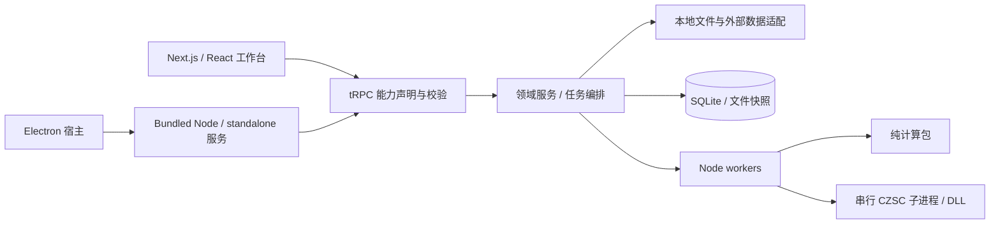

# 系统架构与模块入口

核对日期：2026-11-13。本页描述当前工作树，实施范围见 [roadmap](roadmap.md)，剩余工作见 [next-plan](next-plan.md)，正确性约束见 [invariants](invariants.md)。模块细节按 [模块索引](modules/README.md) 查阅；不把目录存在、方法登记或构建通过当作实际功能验收。

## 总体结构与数据流

[根布局](../src/app/layout.tsx) 安装客户端 provider 和工作台；[API root](../src/server/api/root.ts) 组合业务 router；[runtime](../src/server/runtime.ts) 组合服务生命周期与调度。Electron 管理宿主窗口和 bundled Node，计算与数据访问仍在服务端。开发运行、生产 standalone 验收与正式桌面打包是不同交付范围。

## 页面模型与状态归属

当前仍有两种页面承载方式，不能称为路由统一已完成：

- [Workbench](../src/components/workbench/workbench.tsx) 按路径装配行情、筛选、研究、设置等面板；[routePanels](../src/components/workbench/route-panels.tsx) 补充 RPS、新闻复盘及其他市场面板。部分 `page.tsx` 返回 null，部分虽然返回组件，实际仍由外壳命中的面板呈现。判断归属需同时看路径映射，不能只数 null 页面。
- 未命中面板映射时渲染 Next 的 children，例如首页、证券池、策略中心、任务中心、账本、报告详情与研究数据指南。URL/刷新/前进后退由框架导航承载。
- [PanelCache](../src/components/workbench/keep-alive.tsx) 当前最多保留六个注册面板，行情固定保留；其余按最近访问淘汰。普通路由只使缓存面板隐藏，不占缓存位置或改变淘汰顺序。隐藏通过可见性上下文通知查询，淘汰会卸载组件。组件局部状态不能天然跨淘汰保留；切页也不等于取消服务端任务。

[useWorkbenchState](../src/components/workbench/use-workbench-state.ts) 只保留导航、提示和共享行情会话组合；status 仅选择行情默认来源，并只在行情页主动读取。设置/覆盖、自选列表和模型选择由各可见页面订阅，更新不会因完整 status 透传而重渲染外壳；自选 mutation 属于行情页。任务和通知摘要由 [WorkbenchSidebar](../src/components/workbench/workbench-sidebar.tsx) 订阅，更新不再驱动根组件渲染。侧栏与任务中心共享 taskOverview 全量统计；筛选的 jobs 最近 80 条查询仅用于默认结果发现及显式任务查询的初始信息，不再拿该窗口推算全部活动数。消费者可见且窗口聚焦时才读取/轮询。侧栏观察最新完成扫描的 ID/更新时间刷新覆盖，避免遗漏轮询间快速完成或已移出最近窗口的扫描。

[任务概览仓储](../src/server/db/task-overview.ts) 在同一读取事务内返回全量计数、任务修订号及最新完成扫描的 ID/更新时间；扫描按完成更新时间倒序、ID 倒序确定唯一结果，无扫描时返回 null。统计使用现有任务元数据覆盖索引，不解析输入或大结果，不新增 schema；TaskCenter 和侧栏复用相同查询策略。其余任务历史读取仍在 jobs/task-history，仓储收敛尚未全部完成。

证券名称目录由行情、筛选、档案列表自行订阅，同一查询缓存共享；可见且聚焦时才读取/刷新，不再由外壳透传或驱动外壳重渲染。[行情状态](../src/components/market/use-market-state.ts) 管理证券/周期/来源及快照；筛选、首页、设置、研究分别拥有页面查询和操作。筛选控件与研究问题/方法使用独立会话 store；任务中心已独立为常规路由，通过 connection() 按请求 URL 渲染筛选控件，避免整页静态 Suspense 退为客户端渲染；任务查询仍由客户端缓存负责。已应用筛选由 URL 驱动，草稿/分页与取消反馈由本域会话保留；可分享的任务身份、证券池筛选分页使用 URL；业务实体仍由服务端持久化。

[useTaskVisible](../src/components/workbench/use-task-visible.ts) 合并面板可见性与窗口焦点，供已接入查询停用隐藏轮询。它不是全应用自动拦截器：其余页面生命周期、共享轮询和最终页面模型仍在 P2 范围内。当前状态恢复验收见 [优化交付](deliveries/2026-11-13-optimization.md)。

## 能力与执行边界

[capabilities](../src/lib/common/capabilities.ts) 统一定义能力状态、原因及 read/configure/compute/schedule 操作；[tRPC 边界](../src/server/api/trpc.ts) 要求显式声明并按操作校验。导航/页面使用同一产品策略；直接服务、worker 和调度还须在实际执行入口遵守该策略，不能只隐藏按钮。

- 公式选股、双突破及原生缠论图表可用；输入缺失、计算失败与产品暂停分别表达。
- 旧选股/回测执行、旧样本研究、walk-forward 和四类旧 LLM 分析入口已退役，不提供兼容转发；现行策略中心、研究与回测各自保留。
- 信号监控、信号台账、盘中预选暂停 compute/schedule，可读取现存记录及保存允许的配置；保存设置不恢复调度，重启不补跑、不补发。
- 数字货币模拟账户和新闻复盘按各自既有授权运行，不能从“三个旧调度器暂停”推断全部调度都停用；能力可用也不替代订阅、凭证与交易授权。

能力声明覆盖与退役/暂停边界的实现证据见 [P0 验收表](deliveries/2026-11-13-optimization.md#p0-验收对应表)。

## 服务端职责目录

| 目录                                  | 当前职责                                                     |
| ------------------------------------- | ------------------------------------------------------------ |
| `src/server/data-sources/`            | 本地及供应商数据 IO、协议适配，不承载策略编排                |
| `src/server/market/`、`charts/`       | 证券身份、证券池、日历、行情聚合、图表快照与视图存储         |
| `src/server/screening/`               | RPS/公式任务与候选结果，纯计算委托包或共享规则               |
| `src/server/strategies/`、`research/` | 规则输入/来源适配、原生调用、研究证据与报告编排              |
| `src/server/backtest/`                | 当前回测输入、任务与结果适配，撮合规则由 quant-backtest 提供 |
| `src/server/portfolio/`               | 成交账本、账户与复盘、已授权模拟交易                         |
| `src/server/monitoring/`、`news/`     | 监控/投递边界与新闻复盘；实际调度服从能力策略                |
| `src/server/jobs/`、`infra/`          | 任务与 worker 编排、并发、配置及外部集成基础设施             |
| `src/server/api/`、`db/`、`data/`     | API、共享 SQLite 底座和静态资产                              |

专用 worker/store 随业务域放置。数据源不反向依赖研究或交易编排；客户端不直接导入 server。`src/server/mcp.ts` 及用户维护文案仍按项目指导保护。规则与目录护栏见 [server-layout.test.ts](../tests/engineering-validation/server-layout.test.ts) 和 [策略归属计划](strategy-consolidation-plan.md)。

## 六个计算与数据包

下表依据各包当前 package.json 的工作区依赖；“声明依赖”不表示每个导出都会运行该依赖的 IO。

| 包                                                                      | 责任                                          | 声明的内部依赖                            |
| ----------------------------------------------------------------------- | --------------------------------------------- | ----------------------------------------- |
| [tstdx](../packages/tstdx/package.json)                                 | 通达信协议、本地二进制/财务模型与原生导入边界 | 无                                        |
| [trading-strategy-core](../packages/trading-strategy-core/package.json) | 行情事实、指标、因子与共享规则基础            | tstdx                                     |
| [trading-strategies](../packages/trading-strategies/package.json)       | 策略目录、方法定义/参数、纯策略与研究规则     | trading-strategy-core                     |
| [quant-backtest](../packages/quant-backtest/package.json)               | 回放、撮合、费用、账户与订单执行模型          | trading-strategies、trading-strategy-core |
| [quant-performance](../packages/quant-performance/package.json)         | 独立收益/风险、交易轮次和分期绩效评价         | 无                                        |
| [quant-rps](../packages/quant-rps/package.json)                         | 多周期横截面强度排名                          | 无                                        |

例如 core 的 financial 子路径目前转出 tstdx/financial-model；这层现状不等于已完成下一轮包边界清理。纯策略包不反向导入应用、服务端、撮合包或 IO。绩效评价与撮合事务分开，评价失败不改写已完成交易。`packages:build` 通过 pnpm 依赖图编排六包，共用构建器对源码、工具链、依赖产物和输出校验后跳过未变包。策略身份生成器另外声明源码输入；runtime worker 仍重新打包，不凭包缓存跳过。

## 数据源、持久化与任务

本地行情由 [TDX 服务](../src/server/data-sources/tdx/tdx.ts) 调用 tstdx 读取，证券主档、GBBQ 公司行动、财务与板块分别由所属适配器提供。行情快照明确来源、周期、复权和身份；尾窗可用于筛除，不能代替依赖完整历史的最终确认。原通达信与外部 WDZ Blocks 只读。WDZ 定义快照正在迁出 docs，路径和手动迁出状态见 [数据源说明](data-sources/wdz-blocks/2026-11-07/README.md)。

[SQLite 入口](../src/server/db/index.ts) 从 QUANT_DATA_DIR（未设置时使用本地应用数据目录）打开 quant.sqlite，启用 WAL 并应用 [迁移](../src/server/db/migrations.ts)。当前同时存在通用 records JSON 表及 RPS、图表视图/共享画线、账本等专表；不能将整个数据层描述成仅一张表。通用 `list(kind, limit)` 明确读取最近若干条，必须指定 1–1000 的整数上限，按更新时间和 ID 倒序；不再提供默认 200 或 -1 无上限语义。

`recordPage` 按稳定 ID 顺序返回 items/nextCursor，游标绑定 kind。独立调用读取当时的数据，游标之前的新 ID 不会补入；总计/完整遍历使用 `readRecordSnapshot`，在同一个同步只读事务中每批消费 200 条（另读一条判断后续页），其他连接在扫描中新增、删除或更新的内容留到下次扫描。回调不得写入或异步执行，迭代器不能逃逸事务。渠道、监控定义和公式目录已用完整扫描，仍返回原数组形态；研究使用统计单遍聚合，只保留计数和去重配置集合。目录数组和去重集合仍随规模增长，不能宣称整条链路恒定内存。按类型仓储、其余 raw SQL 和大结果摘要投影仍待 P3 继续整理。

新闻日批次使用启动时固定的已保存 CLS 数据库路径和 Python 可执行文件。新安装不默认连接开发机新闻库，Python 默认从 PATH 查找；设置页分别只读检查数据库字段和解释器版本，不运行模型。技能目录沿用 QUANT_SKILLS_DIR 优先、用户技能目录兜底；现有有效路径不改写。通达信安装目录默认空配置：本地文件读取边界要求明确的绝对路径，不将空字符串解析为工作目录；可选证券元数据返回不可用。已导入完整日线包仍能在未配置安装目录时使用，保留空来源身份，不伪造磁盘目录。行情诊断与财务视图提示配置前置条件；行业/概念 RPS 需要通达信证券范围，缺目录时不开放启动。Blocks 成分来源和目录仍由 RPS 行业页管理，设置页展示并链接，工作流启用不再改写数据源设置。具体边界见[新闻模块](modules/news-cls.md)。

任务详情摘要 `jobSummary` 复用任务元数据投影，按需与首屏结果在同一只读事务返回，不再先解析完整 input/result。[选股结果仓储](../src/server/db/screen-result-pages.ts) 在单条 SQL 内取得总数及候选/隔离/错误各最多 50 条，先搜索排序再分页，显式返回元数据。名称目录一次展开并按证券代码关联，Unicode 大小写和当前/归档名称回退沿用共同规则。SQLite 仍解析存储的 JSON；限制的是返回 JavaScript 的结果行数，不能声称底层零解析或任意行内容恒定字节。完整导出保持独立全量读取，其他大结果与 raw SQL 仍待整理。

SQLite 文件格式与应用 user_version 分开管理：较旧应用拒绝高于自身迁移版本的库。仓储整理不必修改 schema，确需迁移时保留版本保护；开发/测试必须先指定隔离 QUANT_DATA_DIR，不能打开默认用户库来验证迁移。

[jobs](../src/server/jobs/jobs.ts) 管任务提交、取消、进度及重启恢复，[worker](../src/server/jobs/worker.ts) 执行受支持任务。恢复按稳定 ID 分页检查活动任务，保留存活宿主和终态，对中断工作记录状态，不自动补跑旧任务。公式结果按任务身份读取、分页与导出，不能回退到另一成功任务来掩盖失败或缺失。

## 图表与原生缠论

[chart.tsx](../src/components/market/chart.tsx) 保留 React 控件与 effect 编排；实例/资源释放、画线事件、结构投影、基础价格/比较/双突破层、指标层与图例已分为独立模块，入口和生命周期见 [行情图表模块](modules/market-chart.md)。数据、主题和副图切换按层更新；周期、价格精度或视口身份需要重建时恢复共享画线。卸载释放事件、observer、十字线订阅与待执行历史加载帧。

[原生接口](../src/server/strategies/chan/czsc-api.ts) 与 [worker](../src/server/strategies/chan/czsc-worker.ts) 对应 CZSC API v22，配置结构 36 字节；[vendor 清单](../vendor/czsc/README.md) 记录来源 commit 27de580、DLL hash 与 GPLv3 许可。Node 专用子进程通过 koffi 调用 DLL，沿用单一串行所有者，不因图表拆分增加并行原生实例。算法实现留在 DLL；图表负责投影和展示，不能将 TS 近似结果冒作原生结果。

双突破纯规则及来源元数据归 [trading-strategies/research/breakout](../packages/trading-strategies/src/research/breakout/breakout-method.json)，[批量服务](../src/server/strategies/breakout/breakout-batch.ts) 负责文件输入、尾窗筛除及完整确认。公式的解析、静态检查与序列求值归 src/lib/formula，服务编排归 [formula-screen-service](../src/server/screening/formula-screen-service.ts)；不执行生成的 JS，不因恢复入口重新启用旧自动策略。

公式的[计算工作流](../src/server/screening/formula-screen-work.ts)在计算 worker 内保存完整候选快照，只把候选/排除/错误和统计返回应用线程，避免全市场日线对象的结构化克隆阻塞 HTTP。保存每批 50 个快照，事务内检查所属任务仍在运行；取消后不写后续批次。每批提交后等待主进程确认进度，再取得下一批写锁，避免进度和取消操作被连续写入阻塞；进度保存失败会终止 worker 并使任务失败。主进程持有任务终态，快照格式和完整历史不变；分段计算的 worker 内存仍随命中数量增长。

## 验证与尚未完成的边界

当前验证命令、实际覆盖和未验证项集中于 [优化交付](deliveries/2026-11-13-optimization.md)，不在架构说明重复维护测试数量。图表与页面 fixture 测试不等于真实账户联调、生产库升级或桌面发布。

`pnpm check` 在新建隔离数据和临时目录中执行格式、依赖图、runtime、类型、lint、完整测试；可加 `--build` 验证生产构建，遇错停止并保留结果摘要。可选 pre-push 不自动安装。运行错误在所属恢复边界进入独立 `logs/runtime-errors.sqlite`，滚动保留 128 组并限制为 512 KiB；任务中心通过 `recentErrors` 的 tasks/read 能力读取最近 30 组。事件摘要/代码白名单隔离原始供应商异常，任务编号可跳回任务筛选；重复计数、首次/最近时间与已知重试数保留，日志不可读和漏记不伪装成无错误。此文件不改变业务库 schema。

ESLint 使用现有 tsconfig 的类型信息，在 src 检查 Hooks、Promise 与未使用变量。静态 ESM 导入限制 components/lib 执行 server、server 执行 UI 模块，跨层类型引用必须显式声明；另由依赖图检查固定路径的动态 import/require、未解析路径和运行时模块循环；包级图聚合实际源码与声明的构建依赖，检查跨文件/子目录的包循环。ESLint 要求应用和包内动态加载使用固定路径；自定义加载器仍需显式接入规则。研究配置哈希和公式单段扫描已分别归独立模块，记录/尝试服务与总流程/分段调度不再相互导入。显式 void 表示后台意图，不替代异常处理。具体约定见 [conventions](conventions.md)。

测试根目录原有的 66 个支持文件已按职责归入 perf、fixtures/seed、manual、helpers 与 browser/fixtures，所有调用者直接使用新路径，不保留转发入口。固定输入仍保持字节，造数脚本单独参与格式检查；现行入口与人工运行前置见 [测试说明](../tests/README.md)。通用 E2E 的旧场景与预算覆盖仍需按当前业务和隔离要求整理。

页面模型统一、其余状态生命周期、仓储与分页契约及 E2E/性能预算仍按 [最终优化方案](optimization-plan-2026-11-13.md) 推进。本次未升级用户数据库、调用真实通知/交易或制作正式 exe。
