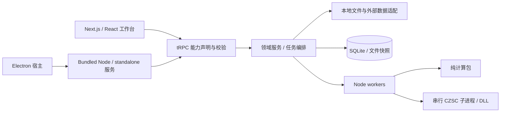

# 系统架构与模块入口

## L0–L5 交易生命周期优化（进行中，2026-11-16）

范围及顺序见[最新优化计划](optimization-plan-2026-11-15.md)。L0 先修正现有提醒、纸面输入、计划与今日投影，不引入新数据库版本；收盘扫描以最近已完成交易日的回执为依据，行情符号只在读取边界归一，冻结研究输入保持原字节。手动影子治理继续由策略登记所有者管理；展示提示不自动启用扫描、live、订阅或镜像。

后续 L1 统一仓位和保护、L2 集中验证判定、L3 扩展策略对象的组合构建、L4 前向一致性和 L5 复盘分别由现有职责域承接。具体接口与迁移在对应批次落地前记录；本段不宣称这些能力已经实现。开发仅做定向检查，完整门禁留到最终集成；状态与实测证据见[交付记录](deliveries/2026-11-16-lifecycle.md)。

## R3c：三个工作区收口

六个工作区保持今日 `/`、扫描与图表 `/scan`、实验室 `/lab`、账户与复盘 `/accounts`、情报 `/intel`、系统 `/system`。A股研究主池为当前中证800，数字货币为BTC/ETH；sleeve 分仓、影子与纸面账本仍由现有所有者管理。本批不新增迁移，当前schema18；验证与截图限定绝对 `.test-data/r3c/`，真实库部署留给管理者。

- 实验室默认列出已登记策略和成绩单状态，详情身份在 `strategy` / `version` URL；方法目录及日线运行比较在 `?tab=catalog`，研究任务在 `?tab=tasks`。证据分析、档案、数据指南保持普通子路由。`db/strategy-lab.ts`投影版本对应的成绩、前推与纸面账户；晋级、影子、策略live、全局模式须用户二次确认，策略操作绑定当前证据修订摘要。发布成绩单及首次纸面登记不自动开启影子；已保存观察不被新报告静默关闭。订阅和渠道仍在系统，开启策略live本身不投递或下单。
- `/lab/backtest`保留原实验，并增加策略对象入口；对象可显式登记到策略列表，版本不可变，登记不启用观察或提醒。`research/lab-backtest.ts`冻结本地BarStore数据并调用同一个`runPortfolio`：A股日线、BTC/ETH原生归档；五分钟仍由原入口执行。需要原生观察、RPS或时点外部输入的规则走已有冻结研究流程，缺输入明确拒绝。参数、本金、费用/公司行动情景、来源和构建摘要随任务保留；结果摘要有界投影，完整冻结输入仅按显式导出读取。
- `scripts/research.ts`与界面worker共用`research/research-command.ts`的只读子集：`inspect <cn-equity|crypto>`、`verify-input <SHA256>`。前者检查已有成绩单，后者核对冻结输入与版本。采集、规模化计算和发布继续使用CLI的显式隔离配置，不从界面执行任意命令或生成代码。
- 情报合并新闻/主题、财联社复盘及持仓计划摘要。`news/intel-service.ts`只读现有已配置新闻存档，按保存名称/代码匹配并披露关联限制；不新增来源或模型摘要。今日显示本日摘要，图表按时间及标题标注，点击展开并跳到精确原文。隐藏图表暂停查询；新闻标注不参与策略求值。
- 系统保留数据连接、任务、提醒渠道和订阅；UI组件示例仅开发模式可见，生产直接404。BTC/ETH保留官方目录/回填并增加只读本地校验worker、索引导出。`db/backups.ts`读取真实`user_version`、库路径与最近成功备份；SQLite online backup包含已提交WAL，默认保留3份、可配1–30份，只轮换本功能创建的成功副本。跨进程租约串行，失败不删成功备份，异常退出的pending由下次持有者清理；删除失败报告错误。
- 成交来源为服务端20行分页的紧凑表格，提醒显示策略名/品种/bar日期/类型，并按精确键定位；键只用于请求、归属和导出。普通证据预览改用字段文本；完整JSON仍可显式导出，策略/公式JSON编辑器保留其编辑用途，受保护MCP诊断文案未改。
- 数字展示统一在`trading-strategy-core/format-number`；Big任意精度资金序列化与固定测试/历史设计样例按逐处理由保留。图标统一Phosphor；三档布局为≤1024、1025–1279、≥1280。暗色控件、条件样式及渲染标记移除；读取旧视图时仅丢弃已退役字段，不改绘图证据。

正式部署顺序：管理者验收差异与隔离门禁 → 关闭旧应用 → 对真实库执行一致性备份 → 部署匹配schema18的source/runtime/build/desktop资源。旧exe拒绝高版本库，不降`user_version`，不复制QA库；真实源目录、DPAPI凭证、live/订阅/镜像保持用户现状，启用仍由用户操作。本单不提交、推送、stash或正式打包，实际检查见`.codex-runs/delivery.json`。

## R3b 账户与复盘

`portfolio/account-workspace-service.ts` 只读投影交割单、手工账本、纸面事实和模拟钱包，原始所有者不变；UI `/accounts` 默认真实持仓，按市场/分仓/类型分组，CNY/USDT各自汇总。普通子页及标签保留导入、现金核对、台账、交易日志和模拟操作；持仓身份在URL，离开不缓存账户页实例。来源人工确认写 `account_trade_links`，每次修订追加 `account_link_audit`；schema18增量迁移，旧exe拒绝新库。

计划写入前在同一事实版本下检查真实持仓与未完成计划预留，超限需显式确认并把上限/明细固化到计划；不调用交易或投递。衰减比较同版本、同参数的入场后20个市场日原价收益，历史分布从完成回测的冻结输入校验并首次保存；旧不等长收益不当作同口径分布。缺行情/除权证据、期初成本、历史行业与完整现金时留空。只提示，不晋级、调参或自动下单。

月度自查复用原回合与归因；计划止损接入同一纪律反事实引擎，超仓同比缩量、追高计划价作固定回合金额对照，保留未平仓/证据不足状态，三类重叠不可相加。原现金重放和逐日证据核对保持独立，不新增平账科目。

## R2c：本地纸面账户

`src/server/paper/` 管候选登记、输入冻结、推进、镜像及评价，`db/paper-repository.ts` 管SQLite。现有任务worker执行计算，runtime每分钟检查，账户revision防止并发覆盖。仓库 `server/data/paper-candidates.json` 冻结R2a-5参数、排名、历史窗口及DSR分布，登记时重新应用原选取规则；目标库登记时刻才是前推起点。默认A股100万CNY、币种10万USDT，可按候选或同批分仓合账；已有事实不能因本金/合账设置变化而重置。

输入逐证券经BarStore完整历史预热，paper驱动复用prepareStrategy；首次原价、决策、执行依据及公司行动冻结，checkpoint只保留前推bar，避免常驻800只完整预热历史。paper组合直接调用runPortfolio，共用费用、滑点、T+1、整手、保护单及R2a-5公司行动情景。A股逐日等下载回执，币种全年按连续完成bar推进；漏bar补记账，不合成缺口，不补发提醒。旧成交/权益前缀变化则拒绝覆盖。评价在记账事务外，失败不撤回成交。

schema17增加账户、checkpoint及分类型事实表和paper-fill提醒。订单、成交、持仓、每日权益、拒单、行动、推进范围/时间和镜像分页查询。2百万前推bar、128MiB checkpoint超限停止并保留证据，不自动淘汰；正式事实留至所有者明确删除。重启从已提交checkpoint复算，未提交计算可重试。

镜像默认关闭，只接受币安demo/testnet与同花顺模拟盘。币安复用adapter、DPAPI凭证版本和跨进程账户writer锁，独占账户并核对余额/镜像库存；意图先落库，只写一次，未知只按客户端编号对账。补推不补单。关闭停止新准入，未知结果保留场所占用，恢复原场所核对。同花顺契约没有唯一委托/成交ID，受理后显示未认证与当日候选证据，不把相似成交冒充逐笔归属，不重发。

今日列纸面变化，账户并列独立模拟区（真实合计默认不含模拟，CNY/USDT不合并），实验室列前推状态，系统 `?tab=paper` 管本金/登记/镜像。权益按20天分页绘图，期望展示原同参数研究分布及偏差；30信号或60实际市场日后复用相同门槛，只给建议。paper-fill须用户开启live及订阅才投递，补推/过期零投递。

核对日期：2026-11-15。本页描述当前工作树，实施范围见 [roadmap](roadmap.md)，剩余工作见 [next-plan](next-plan.md)，正确性约束见 [invariants](invariants.md)。模块细节按 [模块索引](modules/README.md) 查阅；不把目录存在、方法登记或构建通过当作实际功能验收。

## R3a：按交易日组织工作区（2026-11-15）

顶层仅六个入口：今日 `/`、扫描与图表 `/scan`、策略实验室 `/lab`、账户与复盘 `/accounts`、情报 `/intel`、系统 `/system`。旧页面路由直接移除，不设置 redirect/rewrite。四个后续工作区保留普通子路由和各自生命周期；完整映射及验收状态在 `.codex-runs/delivery.json`。

今日默认展示决策面板；`tab=overview` 保留行情脉搏、自选、行业/概念 RPS 与数据时间轴，`tab=intraday` 保留预选历史与配置。`todayWorkspace` 只读提醒事实、官方归档索引和下载回执，不触发下载、通知或策略晋级。市场状态与风险持仓由同一提醒输入所有者保存观察时点；缺失、陈旧与已核对零持仓分开。低位复用历史低位规则，缺估值佐证标记 price-only。BTC 与 ETH 分别采用既有 regime 口径。

扫描工作区内部标签容纳证券池、公式、RPS 管理与涨停池，市场标签容纳数字货币与期货。默认左侧选择已登记策略，中间为服务端筛选分页候选（含 RPS20 后复权列/过滤），右侧保留原生图表全部能力。公式结果与图表同屏；选择继续使用冻结候选快照。点击加入计划才把该冻结候选记为零投递 shadow 观察，随后通过既有 createAlertPlan 校验分仓/风险/数量；原公式缺止损时用户明确填写，不能补造策略保护位。

只有 `/scan` 与 `/lab/backtest` 由外壳保留。Scan 内部图表和公式编辑器按标签显式保留，隐藏时经嵌套 PanelVisibility 暂停查询和快捷键；其余工作区不进入外壳缓存。行情 URL 记忆保留 candidate 身份，普通行情选择仍归 market-session。计划线通过只读上下文临时叠加，原价口径才绘制，不写入用户画线，也不把原价水平画到复权坐标上。

## 总体结构与数据流

[根布局](../src/app/layout.tsx) 安装客户端 provider 和工作台；[API root](../src/server/api/root.ts) 组合业务 router；[runtime](../src/server/runtime.ts) 组合服务生命周期与调度。Electron 管理宿主窗口和 bundled Node，计算与数据访问仍在服务端。开发运行、生产 standalone 验收与正式桌面打包是不同交付范围。

## 页面模型与状态归属

页面默认使用常规 Next 路由；仅 `/scan`、`/lab/backtest` 由 [retainedRoutes](../src/components/workbench/retained-routes.tsx) 显式登记并保留已访问的组件。两个父路由文件均返回同一注册表的真实页面组件，不再返回 null；[Workbench](../src/components/workbench/workbench.tsx) 只对注册路径使用缓存，其余直接呈现框架 children。其余工作区普通页面离开即交由框架管理，不占应用面板缓存，也没有外壳的另一份页面副本。

| 路由                   | 页面模型       | 保留的状态与归属                                                                                                                                                                               |
| ---------------------- | -------------- | ---------------------------------------------------------------------------------------------------------------------------------------------------------------------------------------------- |
| `/`                    | 常规路由       | 排名口径 URL；首页数据 query cache                                                                                                                                                             |
| `/scan?tab=pool`          | 常规路由       | 池、搜索、排序、周期、分页 URL；成分 query cache；翻股列表交给 market-session                                                                                                                  |
| `/scan`              | 显式保留       | 证券、图表周期、来源、复权、图表/财务视图 URL；基础快照周期 `base=5m`；选择/已选快照/候选列表 market-session；图表设置、画线仍按证券×周期经 query cache/服务端保存；图表实例与视窗留在保留组件 |
| `/scan?tab=formula`              | 显式保留       | 任务身份 URL；任务、搜索、排序、分页 screen-session；公式/因子未保存编辑留在保留组件；已保存公式/结果 query cache/服务端                                                                       |
| `/lab/backtest`            | 显式保留       | 实验草稿、当前实验 ID、报告分页留在保留组件；已提交实验/结果 query cache/服务端，刷新后显式恢复实验                                                                                            |
| `/lab/analysis`            | 常规路由       | 问题/方法 research-session；只订阅 market-session.loaded；报告 query cache，提交状态属本页                                                                                                     |
| `/lab/reports`             | 常规路由       | 只订阅 market-session.symbol；报告/财务数据 query cache；工作区切换和未提交估值表单为本页临时状态                                                                                              |
| `/lab/reports/[kind]/[id]` | 常规路由       | 报告身份路径 URL；报告事实服务端                                                                                                                                                               |
| `/system`            | 常规路由       | 未保存设置及对账基准 settings-session（仅内存）；保存结果 query cache/服务端；渠道凭证编辑不持久化                                                                                             |
| `/intel`                | 常规路由       | newsQuery/新闻档案身份 URL；现有新闻会话记忆保存翻页/返回上下文；数据 query cache                                                                                                              |
| `/intel/review`          | 常规路由       | 报告选择/筛选 URL；现有复盘会话记忆；报告事实 query cache/服务端                                                                                                                               |
| `/scan?tab=rps`                 | 常规路由       | 任务、排名 query cache/服务端；内部口径/筛选/分页为本页临时状态，跨页找标的使用 `/scan?tab=pool` 的 URL 流程                                                                                      |
| `/?tab=intraday`            | 常规路由       | 配置和记录 query cache/服务端；操作临时状态本页；旧调度退役；提醒模式由统一引擎拥有                                                                                                            |
| `/system/notifications`             | 常规路由       | 订阅/渠道 query cache/服务端；未提交订阅草稿按 ID/revision 写 sessionStorage，弹窗打开及错误本页；旧调度退役；提醒模式由统一引擎拥有                                                           |
| `/accounts/alerts`       | 常规路由       | 台账事实 query cache/服务端；筛选/选择 URL，分页及返回位置 sessionStorage；不进外壳                                                                                                            |
| `/accounts`        | 常规路由       | 账户、持仓、成交事实 query cache/服务端；交易草稿和提交身份 sessionStorage，刷新将 pending 还原为 unknown 供查询核对                                                                           |
| `/accounts/review`        | 常规路由       | 已导入交割单/复盘事实 query cache/服务端；本页展示控制与账户独立                                                                                                                               |
| `/lab`          | 常规路由       | 方法目录、输入检查/实验 query cache/服务端；选择与展开本页                                                                                                                                     |
| `/lab/data-guide` | 常规路由       | 文档内容；无跨页草稿                                                                                                                                                                           |
| `/scan?tab=sentiment`            | 常规路由       | 日期/所选池 limit-up-store（池持久化，日期仅会话）、池数据 query cache；弹层本页                                                                                                               |
| `/scan?tab=crypto`              | 常规路由       | pair URL；该市场独立来源/周期及未提交表单本页；账户事实 query cache/服务端，不消费 A 股选择                                                                                                    |
| `/scan?tab=futures`             | 常规路由       | code URL；该市场独立来源/周期本页；快照缓存复用，不消费 A 股选择                                                                                                                               |
| `/system/tasks`               | 常规请求时路由 | 已应用筛选 URL；草稿/游标/取消反馈 task-history-session；任务结果 query cache                                                                                                                  |
| `/system/ui-gallery`          | 常规路由       | UI 示例；无业务状态                                                                                                                                                                            |

### 常规页面表单生命周期（E 批核对）

离开指常规路由组件卸载；仅切换本页隐藏子视图仍可能保留该子视图。刷新建立新的内存会话；服务端已受理的任务或写入继续存在，页面返回不会自动重放提交。查询错误由重新读取重新判断，不能把清除提示当作服务端成功。

| 页面                   | 草稿：离开/返回/刷新                                                  | 校验错误与提交中状态                                                             | 当前所有者                                                                           |
| ---------------------- | --------------------------------------------------------------------- | -------------------------------------------------------------------------------- | ------------------------------------------------------------------------------------ |
| `/`                    | 排名 URL；无编辑提交                                                  | 不持久化表单状态                                                                 | [today-overview.tsx](../src/components/overview/today-overview.tsx)                  |
| `/scan?tab=pool`          | 已应用筛选/分页 URL；未提交搜索回到已应用值                           | 无写入提交                                                                       | [stock-pool-view.tsx](../src/components/market/stock-pool-view.tsx)                  |
| `/lab/analysis`            | 问题/方法仅内存，离开返回保留；刷新恢复默认                           | 提交中与错误本页；离开不取消服务器任务，不自动重提                               | [evidence-analysis.tsx](../src/components/workbench/evidence-analysis.tsx)           |
| `/lab/reports`             | 已应用档案查询 URL/分页会话；估值、财务筛选草稿在离开/刷新后重置      | 估值校验/提交反馈本页；保存档案由服务端恢复                                      | [research-archive.tsx](../src/components/workbench/research-archive.tsx)             |
| `/lab/reports/[kind]/[id]` | 身份路径 URL；无编辑草稿                                              | 读取故障可重试，不触发计算                                                       | [page.tsx](../src/app/lab/reports/[kind]/[id]/page.tsx)                                  |
| `/system`            | 设置草稿仅内存，离开返回保留、刷新读已保存值；渠道/凭证草稿离开清空   | 字段/保存错误和 pending 本页；迟到保存按提交快照确认、不清新输入；返回不自动重提 | [connections.tsx](../src/components/workbench/connections.tsx)                       |
| `/intel`                | 已应用查询/任务/档案 URL；翻页返回会话；未应用草稿离开/刷新重置       | 本页错误/提交反馈重置；在途任务按 URL 重新读取，不重新创建                       | [news-panel.tsx](../src/components/news/news-panel.tsx)                              |
| `/intel/review`          | 已应用报告/筛选 URL，分页 sessionStorage；事实/导入草稿离开或刷新清空 | 校验/保存错误/pending 本页；版本控制迟到保存                                     | [cls-review-workspace.tsx](../src/components/news/cls-review-workspace.tsx)          |
| `/scan?tab=rps`                 | 口径/分页/输入本页，离开或刷新重置；已保存配置/排名重新读取           | 校验/操作反馈本页，已有服务端任务继续                                            | [page.tsx](../src/components/workbench/route-panels.tsx)                                                  |
| `/?tab=intraday`            | 未保存配置本页，离开或刷新读已保存配置                                | 错误/提交反馈本页；旧计算/调度退役                                               | [intraday-controls.tsx](../src/components/intraday/intraday-controls.tsx)            |
| `/system/notifications`             | 订阅草稿 sessionStorage，离开/刷新按版本恢复；未应用筛选重置          | 弹窗/校验错误/pending 本页；恢复草稿不是恢复提交，计算调度暂停                   | [monitor-workspace.tsx](../src/components/signals/monitor-workspace.tsx)             |
| `/accounts/alerts`       | 已应用筛选和选中项 URL，分页/位置 sessionStorage；未提交筛选重置      | 本页读取/导出反馈；计算调度暂停                                                  | [signal-ledger-workspace.tsx](../src/components/signals/signal-ledger-workspace.tsx) |
| `/accounts`        | 交易草稿及提交身份 sessionStorage，离开/刷新恢复；UI 展开本页         | 存储解析把 pending 恢复成 unknown；先按原提交 ID 查询，拒绝自动重放              | [trade-ledger-panel.tsx](../src/components/portfolio/trade-ledger-panel.tsx)         |
| `/accounts/review`        | 账户/展示与导入会话按原领域约定恢复，未提交临时展示不进外壳           | 预览提交身份与文件 hash/账户版本绑定；未知响应查收据，不自动重导                 | [trade-review-container.tsx](../src/components/portfolio/trade-review-container.tsx) |
| `/lab`          | 选择/实验输入/搜索本页，离开或刷新重置；目录/已保存实验重新读取       | 日期/资金校验及 pending 本页；离开不取消实验，不自动重提                         | [strategy-center.tsx](../src/components/research/strategy-center.tsx)                |
| `/lab/data-guide` | 静态说明，无草稿                                                      | 无提交                                                                           | [research-data-guide.tsx](../src/components/research/research-data-guide.tsx)        |
| `/scan?tab=sentiment`            | 池持久化、日期仅内存会话；弹层/输入本页，刷新恢复既有池               | 校验/请求反馈本页；读取失败不造结果                                              | [limit-up-store.ts](../src/lib/stores/limit-up-store.ts)                             |
| `/scan?tab=crypto`              | pair URL；独立周期/来源、策略/凭证输入本页；离开或刷新清空            | 提交/故障本页；保存成功清凭证；账户事实服务端，不以 UI pending 推断成交          | [crypto-bot-panel.tsx](../src/components/market/crypto-bot-panel.tsx)                |
| `/scan?tab=futures`             | code URL；来源/周期/选择器本页，离开或刷新重置                        | 读取故障本页，无交易提交                                                         | [futures-view.tsx](../src/components/market/futures-view.tsx)                        |
| `/system/tasks`               | 已应用筛选 URL；草稿/游标 task-history-session，刷新回 URL 首页       | 取消中状态按 ID 跨卸载保留；刷新查服务器，不自动重提取消                         | [task-history-session.ts](../src/lib/stores/task-history-session.ts)                 |
| `/system/ui-gallery`          | 示例草稿本页，离开/刷新重置                                           | 示例校验/反馈无业务提交                                                          | [ui-gallery.tsx](../src/components/common/ui-gallery.tsx)                            |

逐页代码核对覆盖以上普通路由；新增实际组件验证覆盖设置草稿/校验/提交/卸载/刷新，负对照故意保留组件后在“错误必须清除”断言失败。策略和估值的框架路由验证见 route-visual，研究/设置/任务的既有路由恢复用例保留。该覆盖不代表每个真实外部提交均已联调。

[market-session](../src/lib/stores/market-session.ts) 是共享行情选择的具名所有者；可分享字段以当前行情 URL 为导航权威，写入使用原生 history 与 Next 的 search params 同步，刷新重新解析。跨页选择命令通过 [ChartNavigationProvider](../src/components/market/open-chart.tsx) 读取当前字段并导航，不在外壳订阅，也不在来源页提前加载。筛选接受已保存候选快照时推进选择修订号，旧请求的迟到成功、失败与加载状态不能覆盖新候选。候选列表/精确快照留在当前内存会话，刷新行情恢复选择并重新读取；要重开原始候选证据从带任务身份的筛选页进入。

[useMarketState](../src/components/market/use-market-state.ts) 只由行情页面安装加载器，默认来源与自选也由可见行情页读取。档案仅订阅证券，研究和回测仅订阅已加载快照，筛选只持有选中候选的命令。外壳保留导航、toast，任务/通知摘要继续由侧栏消费；共享查询结果仍归现有 query cache，未搬入大 store。

生命周期：登记工作区与其内部标签首次访问才挂载，之后在当前工作台会话内保留（父路由注册数二，公式为扫描内部标签，不发生 LRU 淘汰）；普通路由不改变缓存顺序。离开时 [PanelVisibility/useTaskVisible](../src/components/workbench/keep-alive.tsx) 停止页面查询/轮询与键盘捕获，切页不取消已提交服务端任务；已在途请求可结束。返回恢复视窗和草稿；刷新、工作台卸载或错误边界重建会重新挂载，选择从 URL、已保存内容从服务端、具名内存草稿从当前会话恢复，未保存的筛选/回测组件草稿不承诺跨刷新保留。图表卸载沿用既有实例清理，释放订阅、observer 与引用，不改变 CZSC 单进程串行边界。

本机小型合成 fixture 单次实测：行情首开 498.2ms，财务往返恢复原图表节点 127.0ms；筛选首开/返回 156.3/45.6ms，回测 119.8/50.3ms。时间包含导航、模块和数据读取，不是单独的挂载成本，也不代表完整规模性能。

保留范围由图表实例/视窗及公式、因子、回测未保存编辑的实际存活需求决定；其余页面使用显式状态与 query cache。切换成本、挂载存活、负对照和恢复实测见 [当前交付](deliveries/2026-11-13-optimization.md#当前验证)，不以缓存本身或代码行数宣称性能收益。本轮工作区和UI收口见文首R3c；尚未覆盖的真实外部场景继续单独验收。

## 能力与执行边界

[capabilities](../src/lib/common/capabilities.ts) 统一定义能力状态、原因及 read/configure/compute/schedule 操作；[tRPC 边界](../src/server/api/trpc.ts) 要求显式声明并按操作校验。导航/页面使用同一产品策略；直接服务、worker 和调度还须在实际执行入口遵守该策略，不能只隐藏按钮。

- 公式选股、双突破及原生缠论图表可用；输入缺失、计算失败与产品暂停分别表达。
- 旧选股/回测执行、旧样本研究、walk-forward 和四类旧 LLM 分析入口已退役，不提供兼容转发；现行策略中心、研究与回测各自保留。
- 信号监控、台账、预选旧 compute/schedule 入口退役，可读取历史并配置；统一提醒引擎默认shadow，保存旧设置不恢复旧调度，重启不补跑、不补发。
- 数字货币模拟账户和新闻复盘按各自既有授权运行，不能从“三个旧调度器暂停”推断全部调度都停用；能力可用也不替代订阅、凭证与交易授权。

能力声明覆盖与退役/暂停边界的实现证据见 [P0 验收表](deliveries/2026-11-13-optimization.md#p0-验收对应表)。

## 服务端职责目录

| 目录                                  | 当前职责                                                     |
| ------------------------------------- | ------------------------------------------------------------ |
| `src/server/data-sources/`            | 本地及供应商数据 IO、协议适配，不承载策略编排                |
| `src/server/market/`、`charts/`       | 证券身份、证券池、日历、行情聚合、图表快照与视图存储         |
| `src/server/screening/`               | RPS/公式任务与候选结果，纯计算委托包或共享规则               |
| `src/server/strategies/`、`research/` | 规则输入/来源适配、原生调用、研究证据与报告编排              |
| `src/server/backtest/`                | 当前回测输入、任务与结果适配，撮合规则由 quant-backtest 提供 |
| `src/server/portfolio/`               | 成交账本、账户与复盘、已授权模拟交易                         |
| `src/server/monitoring/`、`news/`     | 监控/投递边界与新闻复盘；实际调度服从能力策略                |
| `src/server/jobs/`、`infra/`          | 任务与 worker 编排、并发、配置及外部集成基础设施             |
| `src/server/api/`、`db/`、`data/`     | API、共享 SQLite 底座和静态资产                              |

专用 worker/store 随业务域放置。数据源不反向依赖研究或交易编排；客户端不直接导入 server。`src/server/mcp.ts` 及用户维护文案仍按项目指导保护。规则与目录护栏见 [server-layout.test.ts](../tests/engineering-validation/server-layout.test.ts) 和 [策略归属计划](strategy-consolidation-plan.md)。

## 六个计算与数据包

下表依据各包当前 package.json 的工作区依赖；“声明依赖”不表示每个导出都会运行该依赖的 IO。

| 包                                                                      | 责任                                          | 声明的内部依赖                            |
| ----------------------------------------------------------------------- | --------------------------------------------- | ----------------------------------------- |
| [tstdx](../packages/tstdx/package.json)                                 | 通达信协议、本地二进制/财务模型与原生导入边界 | 无                                        |
| [trading-strategy-core](../packages/trading-strategy-core/package.json) | 行情事实、指标、因子与共享规则基础            | tstdx                                     |
| [trading-strategies](../packages/trading-strategies/package.json)       | 策略目录、方法定义/参数、纯策略与研究规则     | trading-strategy-core                     |
| [quant-backtest](../packages/quant-backtest/package.json)               | 回放、撮合、费用、账户与订单执行模型          | trading-strategies、trading-strategy-core |
| [quant-performance](../packages/quant-performance/package.json)         | 独立收益/风险、交易轮次和分期绩效评价         | 无                                        |
| [quant-rps](../packages/quant-rps/package.json)                         | 多周期横截面强度排名                          | 无                                        |

例如 core 的 financial 子路径目前转出 tstdx/financial-model；这层现状不等于已完成下一轮包边界清理。纯策略包不反向导入应用、服务端、撮合包或 IO。绩效评价与撮合事务分开，评价失败不改写已完成交易。`packages:build` 通过 pnpm 依赖图编排六包，共用构建器对源码、工具链、依赖产物和输出校验后跳过未变包。策略身份生成器另外声明源码输入；runtime worker 仍重新打包，不凭包缓存跳过。

## 数据源、持久化与任务

行情序列统一经 [BarStore](../src/server/market/bar-store/read-bars.ts) 读取；标的具有 `cn-equity/crypto/futures` 市场身份，客户端与回测共用的 [市场规则表](../packages/trading-strategy-core/src/market-rules.ts) 集中提供交易时段、结算、数量、涨跌停、费用模板与做空能力。期货合约时段/费用与数字货币数量步长没有凭据时为未知，不赋予执行授权；期货行情本单继续使用原有合约适配。

BarStore 在 QUANT_DATA_DIR/bar-store 保存原价 QBARCOL1 文件：16 KiB 版本/来源头、Float64/Int32 列块，前缀不变时追加，修订时替换。v2 头部与完整列内容使用 CRC32 检查损坏，写入仍记录 SHA256；v1 文件先验证 SHA256，再在写锁内只升级头部，不重写列数据。来源指纹保留 inode/size/mtime/ctime/birthtime 与 SHA256：稳定读取整份源文件后以全内容 CRC32 探测变化，进程首次或探针改变时求 SHA256，最多保留 32768 个小型身份记录。即使 Windows 保留相同时间戳，首部、中部与尾部修订也进入变化检测；这是本地意外损坏检测，不是恶意篡改认证。列文件每次读取并校验，单文件上限 128 MiB；不共享可变 bars，只复用最多各 65536 个日线/盘中日期标签。已校验基础日线只标完成状态，不重新分组/合成；复权价格仍检查溢出与下溢。读取时使用 tstdx 的 GBBQ 因子，进程按来源身份共享一次解析（包括并发首次读取），历史截止先于前复权分母选择；分红文件缺失即失败，不降级。公式与双突破的信号使用前复权，RPS 的资格/事件校验后使用后复权；回测成交与账户仍取原价。公式候选冻结信号 bars 与对应原价供图表重开，不能拿今天的新历史替换原候选。

A 股日/5分钟与完整包进入同一读取路径；完整包新导入只写列文件和小型 records 指针，旧 bars JSON 在首次读取时迁出到列文件，旧 records 行原样保留。日线包基准的窗口解码仍由 tstdx 的专用窗口解析保护旧脏记录边界。已暂停 g4day 的发布收据与下载编排保留，未作为第二条策略取数路径重新启用。

日线→周/月、5分钟→15/30/60分钟采用 [纯聚合](../src/lib/market/bar-aggregation.ts)，数字货币 7×24 UTC 聚合单独遵守连续时段，1h→4h、日线→周/月；覆盖缺口及 formingDates 明确返回。数字货币公开行情按已缓存窗口增量更新尾段，来源改变不拼接两家历史。图表今日叠加经过已有重叠价量核对，仅标记为未完成覆盖，不写回原价缓存；源能力不足的周期不提供选择。

证券主档、GBBQ、财务与板块的协议和本地解码仍归 tstdx，扫描器只负责证券目录及名称政策。通达信和外部 Blocks 只读。管理者提交 f73f7db 已记录 WDZ 定义归档至 D:/quant-data/wdz-blocks/2026-11-07，仓库保留 manifest；本单不改变源快照、归档或恢复程序。

[SQLite 入口](../src/server/db/index.ts) 从 QUANT_DATA_DIR（未设置时使用本地应用数据目录）打开 quant.sqlite，启用 WAL 并应用 [迁移](../src/server/db/migrations.ts)。当前同时存在通用 records JSON 表及 RPS、图表视图/共享画线、账本等专表；不能将整个数据层描述成仅一张表。通用 `list(kind, limit)` 明确读取最近若干条，必须指定 1–1000 的整数上限，按更新时间和 ID 倒序；不再提供默认 200 或 -1 无上限语义。

`recordPage` 按稳定 ID 顺序返回 items/nextCursor，游标绑定 kind。独立调用读取当时的数据，游标之前的新 ID 不会补入；总计/完整遍历使用 `readRecordSnapshot`，在同一个同步只读事务中每批消费 200 条（另读一条判断后续页），其他连接在扫描中新增、删除或更新的内容留到下次扫描。回调不得写入或异步执行，迭代器不能逃逸事务。渠道、监控定义和公式目录已用完整扫描，仍返回原数组形态；研究使用统计单遍聚合，只保留计数和去重配置集合。目录数组和去重集合仍随规模增长，不能宣称整条链路恒定内存。任务读写/历史/侧栏及监控、信号、投递工作区已归 `src/server/db/` 类型仓储；原路径移除，调用者直接依赖仓储。E 批把图表、RPS、盘中历史、信号台账、新闻、交易/交割、数字货币账户、研究档案与治理仓储继续迁入 db；API 处理器不再直接执行 SQL。源库读取、独立诊断日志与跨域原子用例的保留调用逐条登记在 delivery.json，不宣称 db 以外零 SQLite 调用。

新闻日批次使用启动时固定的已保存 CLS 数据库路径和 Python 可执行文件。新安装不默认连接开发机新闻库，Python 默认从 PATH 查找；设置页分别只读检查数据库字段和解释器版本，不运行模型。技能目录沿用 QUANT_SKILLS_DIR 优先、用户技能目录兜底；现有有效路径不改写。通达信安装目录默认空配置：本地文件读取边界要求明确的绝对路径，不将空字符串解析为工作目录；可选证券元数据返回不可用。已导入完整日线包仍能在未配置安装目录时使用，保留空来源身份，不伪造磁盘目录。行情诊断与财务视图提示配置前置条件；行业/概念 RPS 需要通达信证券范围，缺目录时不开放启动。Blocks 成分来源和目录仍由 RPS 行业页管理，设置页展示并链接，工作流启用不再改写数据源设置。具体边界见[新闻模块](modules/news-cls.md)。

任务详情摘要 `jobSummary` 复用任务元数据投影，按需与首屏结果在同一只读事务返回，不再先解析完整 input/result。[选股结果仓储](../src/server/db/screen-result-pages.ts) 在单条 SQL 内取得总数及候选/隔离/错误各最多 50 条，先搜索排序再分页，显式返回元数据。名称目录一次展开并按证券代码关联，Unicode 大小写和当前/归档名称回退沿用共同规则。SQLite 仍解析存储的 JSON；限制的是返回 JavaScript 的结果行数，不能声称底层零解析或任意行内容恒定字节。公式完整导出由 `job-results` 在同步只读快照内逐行组装，单次 DB→JS 载荷最多 256 KiB；超大行按 UTF-8 字节分块，迭代器随快照关闭，外部并发提交留到下次读取。回测结果页只投影摘要及每页最多 50 笔成交/订单，待执行订单与权益曲线沿现行详情契约按需返回，冻结行情按完整评价/导出请求读取；完整回测档案也按数组迭代/字节分块组装。最终导出对象与 HTTP/浏览器序列化仍随总结果增长，SQLite 内部解析/排序内存也没有恒定上界；此处保证跨边界读取有界，并非端到端流式下载。

任务、监控、信号和投递的分页顺序都有唯一 ID/数组位置作为 tie-breaker，返回 `items/nextCursor/hasMore`；恢复任务及投递先冻结 ID 集再更新，新增 ID 留到下次。新任务完整校验，更新不补造历史记录缺字段；类型仓储在立即事务内检查 ID 不跨 kind 覆盖。ESLint 通过 TypeScript 方法声明识别真实 SQLite 调用，覆盖全部服务端业务代码；源库/独立日志按所有者保留，列明的跨域用例只允许 transaction，仍禁止 prepare/exec；其他对象的同名方法不受影响。

SQLite 文件格式与应用 user_version 分开管理：较旧应用拒绝高于自身迁移版本的库。仓储整理不必修改 schema，确需迁移时保留版本保护；开发/测试必须先指定隔离 QUANT_DATA_DIR，不能打开默认用户库来验证迁移。

[jobs](../src/server/jobs/jobs.ts) 管任务提交、取消、进度及重启恢复，[worker](../src/server/jobs/worker.ts) 执行受支持任务。恢复先冻结按 ID 排序的活动任务集合，再在立即事务中逐项复查，保留存活宿主和终态，对中断工作记录状态，不自动补跑旧任务。公式结果按任务身份读取、分页与导出，不能回退到另一成功任务来掩盖失败或缺失。

## 图表与原生缠论

[chart.tsx](../src/components/market/chart.tsx) 保留 React 控件与 effect 编排；实例/资源释放、画线事件、结构投影、基础价格/比较/双突破层、指标层与图例已分为独立模块，入口和生命周期见 [行情图表模块](modules/market-chart.md)。数据、指标和副图切换按层更新；周期、价格精度或视口身份需要重建时恢复共享画线。卸载释放事件、observer、十字线订阅与待执行历史加载帧。

[原生接口](../src/server/strategies/chan/czsc-api.ts) 与 [worker](../src/server/strategies/chan/czsc-worker.ts) 对应 CZSC API v22，配置结构 36 字节；[vendor 清单](../vendor/czsc/README.md) 记录来源 commit 27de580、DLL hash 与 GPLv3 许可。Node 专用子进程通过 koffi 调用 DLL，沿用单一串行所有者，不因图表拆分增加并行原生实例。算法实现留在 DLL；图表负责投影和展示，不能将 TS 近似结果冒作原生结果。

双突破纯规则及来源元数据归 [trading-strategies/research/breakout](../packages/trading-strategies/src/research/breakout/breakout-method.json)，[批量服务](../src/server/strategies/breakout/breakout-batch.ts) 负责文件输入、尾窗筛除及完整确认。公式的解析、静态检查与序列求值归 packages/trading-strategies/src/formula，服务编排归 [formula-screen-service](../src/server/screening/formula-screen-service.ts)；不执行生成的 JS，不因恢复入口重新启用旧自动策略。

公式的[计算工作流](../src/server/screening/formula-screen-work.ts)在计算 worker 内保存完整候选快照，只把候选/排除/错误和统计返回应用线程，避免全市场日线对象的结构化克隆阻塞 HTTP。保存每批 50 个快照，事务内检查所属任务仍在运行；取消后不写后续批次。每批提交后等待主进程确认进度，再取得下一批写锁，避免进度和取消操作被连续写入阻塞；进度保存失败会终止 worker 并使任务失败。主进程持有任务终态，快照格式和完整历史不变；分段计算的 worker 内存仍随命中数量增长。

## 验证与尚未完成的边界

当前验证命令、实际覆盖和未验证项集中于 [优化交付](deliveries/2026-11-13-optimization.md)，不在架构说明重复维护测试数量。图表与页面 fixture 测试不等于真实账户联调、生产库升级或桌面发布。

`pnpm check` 在新建隔离数据和临时目录中执行格式、依赖图、runtime、类型、lint、完整测试；可加 `--build` 验证生产构建，遇错停止并保留结果摘要。可选 pre-push 不自动安装。运行错误在所属恢复边界进入独立 `logs/runtime-errors.sqlite`，滚动保留 128 组并限制为 512 KiB；任务中心通过 `recentErrors` 的 tasks/read 能力读取最近 30 组。事件摘要/代码白名单隔离原始供应商异常，任务编号可跳回任务筛选；重复计数、首次/最近时间与已知重试数保留，日志不可读和漏记不伪装成无错误。此文件不改变业务库 schema。

ESLint 使用现有 tsconfig 的类型信息，在 src 检查 Hooks、Promise 与未使用变量。静态 ESM 导入限制 components/lib 执行 server、server 执行 UI 模块，跨层类型引用必须显式声明；另由依赖图检查固定路径的动态 import/require、未解析路径和运行时模块循环；包级图聚合实际源码与声明的构建依赖，检查跨文件/子目录的包循环。ESLint 要求应用和包内动态加载使用固定路径；自定义加载器仍需显式接入规则。研究配置哈希和公式单段扫描已分别归独立模块，记录/尝试服务与总流程/分段调度不再相互导入。显式 void 表示后台意图，不替代异常处理。具体约定见 [conventions](conventions.md)。

测试根目录原有的 66 个支持文件已按职责归入 perf、fixtures/seed、manual、helpers 与 browser/fixtures，所有调用者直接使用新路径，不保留转发入口。固定输入仍保持字节，造数脚本单独参与格式检查；现行入口与人工运行前置见 [测试说明](../tests/README.md)。通用 E2E 已改为独立隔离生产服务与 6,154 只合成证券负载，仍沿用原预算；D 批 10 项全规模通过的证据见交付，不能外推到真实账户和所有数据源。

本批页面模型和共享行情归属已收拢；常规页面表单已按下表核对，仍未关闭的真实外部状态与最终验收按 [最终优化方案](optimization-plan-2026-11-13.md) 推进。本次未升级用户数据库、调用真实通知/交易或制作正式 exe。

## R1b 策略与回放

`trading-strategies/strategy-object`（包根导出）拥有 id/version/market/period/universe/entry/exit/sizing/sleeve。`prepareStrategy`编译纯规则并按完成bar索引求值；原生CZSC只消费服务端已有串行worker冻结的观察，禁止DLL进入包。公式解释器已整体迁入包，所有消费者直接导入公开formula子路径，无旧路径转发。

`quant-backtest.runPortfolio`提供多证券、市场规则、分仓现金、分批、次根开盘、bar内保护单和订单/成交/权益/拒单记录。`portfolio-account.ts`拥有共同账本和事件时钟；五分钟、经典日线及中证800研究保留具名输入/决策/结果投影，成交记账通过共同账本，旧五个run入口及私有账户实现移除。显式中证800收盘集合竞价实验仍按冻结假设回放，不当作次开盘或可信历史成交；绩效归独立quant-performance。

应用历史信号通过readBars前复权读取并冻结分母，成交使用对应rawBars。旧离线冻结输入缺signalBars时按其已记录的因果分红/经济权益口径读取，不改写历史输入。组合任务最多6000标的、200万根冻结行情（含基准）、10万标的×周度决策；边界控制Node堆、证据与导出载荷，区间与证券数不再独立限50只/两年。超预算明确拒绝，不截断研究。分仓再平衡只划转闲置现金，持仓超配待资金释放，不强制平仓。

## R1c 驱动与策略持久化

`src/server/strategies/drivers/` 提供 scan、backtest、watch、paper。`evaluation.ts`在固定截止前缀调用`prepareStrategy`；scan给出原价入场/保护/目标参考、sleeve及可得的数量建议，数量不含费用滑点，缺平台数量规则时留空。backtest交给`runPortfolio`，完成bar决策、次开盘撮合；watch只产生完成bar事件，paper将其投影为买卖意图。保护价触发及歧义优先级由策略包的`strategyProtection`共同拥有，不读取本bar高点抬高本bar止损。

公式任务和分片携带策略对象，原有任务/取消/进度/快照/分页/导出保持。双突破尾窗只否决，完整历史经策略对象确认；指标和形态详情仍用规则拥有方的输出。五分钟页面提交归一策略对象，旧MA信号算法移至测试参考，无运行时兼容导出。策略中心组合入口支持显式`strategy`对象；已有周度横截面目标权重再平衡继续走现有allocation profile，不能把它替换成固定权重买入而丢失减仓能力。

数字货币tick使用paper/watch事件准入；平台报价、数量门槛、账户隔离、意图先持久化、未知结果对账仍由原账户所有者和adapter管理。直接`cryptoDualMa`读数仅作既有指标展示，买卖方向取paper意图。A股模拟盘保留60秒一次性人工预览，不从纯paper意图直接发送委托。三个暂停调度器不恢复，watch持久化入口不调用通知。

迁移15新增`strategies`、`trade_plans`、`watch_events`。策略id/version下定义不可改写，新定义使用新正整数版本；事件按策略版本×市场×标的×bar唯一，类型单独记录。类型仓储在同一事务保存定义、事件及可选计划，重复事件保留首次证据。`persistWatch`显式调用才创建事件/有数量依据的计划。持久记录不按容量自动淘汰，保留至所有者明确删除；事务失败回滚，重放去重。测试及临时SQLite由本单cleanup脚本在验收后手动清理。此schema高于现有旧exe，旧应用会拒绝打开升级库；本单不升级用户库、不制作正式包。

## R2b 统一提醒与计划

`src/server/alerts/engine.ts`注入时钟、日历、回执、leader租约、完成行情求值和投递接口；runtime仅调用tickAlerts，不再启动旧监控循环/台账/预选调度。数字货币每分钟检查最近完成bar，A股交易时段检查5分钟持仓与计划，15:05–16:00等待下载回执后扫描live策略生成明日候选；迟到或中断窗口记录missed，不做历史扫描补发。

`inputs.ts`经BarStore读取完成行情，信号前复权、保护价和成交参考原价；watch复用R1c驱动，原生缠论仍经单串行worker。持仓关闭穿越止损/目标/移动止损仅提醒；持续越线不重复，回线后新bar再次越线重提醒。移动最高价仅来自此前已观察完成bar收盘。指数/BTC基线是收盘/SMA20/SMA60与120根收盘分位，明确不是完整市场温度。

schema16只扩展watch_events的事件种类、空价格与提醒状态，既有数据不改写；策略版本/事件唯一键保持。引擎状态、订阅版本、首次结算的前瞻收益复用records。AlertRepository拥有SQLite事务、分页与导出；事件、状态、计划终态和outbox入队在同一事务提交。保留证据直到所有者明确删除，不自动淘汰交易事实。

settings.alerts默认shadow；live须实验室显式二次确认，且新提醒订阅启用。enqueueAlert复用NotificationPolicyStore和现有outbox；影子只写决策，入队/领取/凭证读取后再次检查模式、订阅版本、渠道与静默。旧订阅不静默转换为新投递授权。台账默认读提醒历史，旧台账仍可查询。前瞻收益复用ledgerOutcome的T+1开盘/T+5/10/20收盘、原价、缺失及GBBQ三态；数字货币用UTC自然日，无股票除权。两者均非策略业绩。

交易计划按用户配置的分仓资本、份额、单笔风险、已核对持仓和未完成计划预留额度计算；A股整手，币种数量必须有平台步长/最小数量依据。分批每档均为向上达到入场价时一次提醒；仅全部触发才关闭计划，部分触发仍保守预留全计划额度，取消/到期释放。无真实委托调用。真实1–2周影子观察仍属后续运行验收。

## R2a 冻结验证与研究成绩单

规模化研究可以通过显式绝对 `QUANT_RESEARCH_BAR_STORE_DIR` 复用工作区 `.test-data` 内的 BarStore；应用默认值保持随 QUANT_DATA_DIR 隔离，检查/测试子进程不继承研究覆盖。币安研究使用独立原生 15m 缓存，源时间隔离和严格价格校验分开；回补页失败保留已验证覆盖并记录缺口，最后从缓存冻结，不因再一次联网失败丢弃已有历史。

`trading-strategies/historical-low` 拥有5–10年观察价格分位、距前高回撤及可得PE/PB/市场温度的置信标签；`lowZoneCycles` 将首次低位、加深与恢复归为周期。`researchCandidates` 声明两个市场的分仓、周期与ATR/移动/时间退出规则；原生三买仍只消费固定起点的串行worker观察。

`quant-backtest.runValidationSuite` 只编排纯回放窗口和预先定义的晋级条件，评价由应用注入的quant-performance适配完成。固定训练窗向前滚动、只在训练窗排名；独立本金的测试窗另跑成本×2与延后一根压力。初始训练段用于数值邻域稳定性，末20%固定留出诊断与滚动样本外重叠，不能累加为独立样本或据此调参。DSR和CSCV复用现有模块，CSCV夏普对照不冒称精确检验了超额/回撤的训练选择器。

`src/server/research/validation-*` 负责本地池/财务/原生观察和公开币种行情的冻结、版本校验及任务编排。输入和结果按SHA256保存于隔离数据目录的`research-validation/`，单文件256MiB、总量4GiB、最多100文件，超限拒绝新运行，不自动淘汰证据；管理者验收后手动清理，异常退出遗留pending由同一脚本处理。输入同时绑定策略/撮合构建与研究/评价适配构建，漂移拒绝重放。`strategyValidationRun`/`strategyValidationReplay`进入已有任务worker，保留取消/进度；不会在HTTP线程做全套计算。

证券池冻结本地可枚举名单、已有上市/退市缓存与供应商代码记录；未知上市日不以首根行情替代，退市统计只作下界。研究样本按事先声明的名单确定，不声称完整历史市场。R2a-2 按用户“免费数据优先、缺口标注”选择，将历史池不完整、成交/到账和平台数量/流动性未核验改为高严重度偏差标签，不再阻断统计晋级；样本外、超额、回撤、交易数、邻域、DSR、成本/延迟和留出门槛保持。`validation-scoreboard`仓储保存有界成绩单投影，页面使用服务端排序/20行分页；输入/结果细节留在内容寻址文件。分仓资格同时保存偏差标签，不改实时模式、订阅、outbox或账户。

研究采集复用财务池读取器一次读取 FN96/FN271，GP16 保留同日重复、未知日期与完整来源哈希；按日期索引仍调用原有财务计算。币安研究 15m 显式请求原生周期并缓存到独立周期键，普通图表仍取 5m 聚合。非网格收线记录保留在原始缓存，研究视图单列隔离及缺口，不修时间、不补 bar，聚合器与非法价格检查仍严格拒绝。零持续时间等其他非法源记录仍使相应历史回补失败并保留已取得的覆盖。

A股组合取指数与池内有效个股的最深低位目标，比较0/30/35/40与固定65/35；已知退市日后移除该个股目标。数字货币组合将完成的4h波段和1h突破决策投影到同一15m撮合时钟，时间退出按周期时长换算，保护单在15m检查。一个账户真实回放，不平均独立策略收益；分仓相关性扣除现金划转，零资本区间留空。仅可用闲置现金再平衡，不强制平仓。

### 币安持久本地行情源（R2a-4）

BTC/ETH的官方镜像目录由`binancePublicDataRoot`设置指定，默认`QUANT_DATA_DIR/market-data/binance-public-data`。`data-sources/binance/public-data`负责12列/时间戳/校验，`public-data-store`负责原样归档、显式回填、索引及已完成实时尾部；任务宿主与worker执行分开。每个原生周期独立读源，4h不从1h聚合。BarStore对选中文件验证SHA并存派生列缓存；缓存清理不得触碰ZIP、CHECKSUM、liveCSV和manifest。索引只存覆盖/缺口/校验元信息，不另建K线SQL表。启动提示没有历史时，只提供设置入口，不自动批量回填。普通实时读取仅在已有索引时按bar边界补最近尾部。
