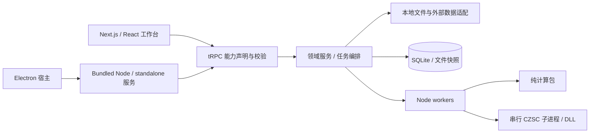

# 系统架构与模块入口

核对日期：2026-11-14。本页描述当前工作树，实施范围见 [roadmap](roadmap.md)，剩余工作见 [next-plan](next-plan.md)，正确性约束见 [invariants](invariants.md)。模块细节按 [模块索引](modules/README.md) 查阅；不把目录存在、方法登记或构建通过当作实际功能验收。

## 总体结构与数据流

[根布局](../src/app/layout.tsx) 安装客户端 provider 和工作台；[API root](../src/server/api/root.ts) 组合业务 router；[runtime](../src/server/runtime.ts) 组合服务生命周期与调度。Electron 管理宿主窗口和 bundled Node，计算与数据访问仍在服务端。开发运行、生产 standalone 验收与正式桌面打包是不同交付范围。

## 页面模型与状态归属

页面默认使用常规 Next 路由；仅 `/market`、`/screen`、`/backtest` 由 [retainedRoutes](../src/components/workbench/retained-routes.tsx) 显式登记并保留已访问的组件。三个路由文件均返回同一注册表的真实页面组件，不再返回 null；[Workbench](../src/components/workbench/workbench.tsx) 只对注册路径使用缓存，其余直接呈现框架 children。普通页面离开即交由框架管理，不占应用面板缓存，也没有外壳的另一份页面副本。

| 路由 | 页面模型 | 保留的状态与归属 |
| --- | --- | --- |
| `/` | 常规路由 | 排名口径 URL；首页数据 query cache |
| `/stock-pool` | 常规路由 | 池、搜索、排序、周期、分页 URL；成分 query cache；翻股列表交给 market-session |
| `/market` | 显式保留 | 证券、图表周期、来源、复权、图表/财务视图 URL；基础快照周期 `base=5m`；选择/已选快照/候选列表 market-session；图表设置、画线仍按证券×周期经 query cache/服务端保存；图表实例与视窗留在保留组件 |
| `/screen` | 显式保留 | 任务身份 URL；任务、搜索、排序、分页 screen-session；公式/因子未保存编辑留在保留组件；已保存公式/结果 query cache/服务端 |
| `/backtest` | 显式保留 | 实验草稿、当前实验 ID、报告分页留在保留组件；已提交实验/结果 query cache/服务端，刷新后显式恢复实验 |
| `/analysis` | 常规路由 | 问题/方法 research-session；只订阅 market-session.loaded；报告 query cache，提交状态属本页 |
| `/reports` | 常规路由 | 只订阅 market-session.symbol；报告/财务数据 query cache；工作区切换和未提交估值表单为本页临时状态 |
| `/reports/[kind]/[id]` | 常规路由 | 报告身份路径 URL；报告事实服务端 |
| `/settings` | 常规路由 | 未保存设置及对账基准 settings-session（仅内存）；保存结果 query cache/服务端；渠道凭证编辑不持久化 |
| `/news` | 常规路由 | newsQuery/新闻档案身份 URL；现有新闻会话记忆保存翻页/返回上下文；数据 query cache |
| `/cls-review` | 常规路由 | 报告选择/筛选 URL；现有复盘会话记忆；报告事实 query cache/服务端 |
| `/rps` | 常规路由 | 任务、排名 query cache/服务端；内部口径/筛选/分页为本页临时状态，跨页找标的使用 `/stock-pool` 的 URL 流程 |
| `/intraday` | 常规路由 | 配置和记录 query cache/服务端；操作临时状态本页；compute/schedule 继续暂停 |
| `/signals` | 常规路由 | 订阅/渠道 query cache/服务端；未提交弹窗本页；compute/schedule 继续暂停 |
| `/signal-ledger` | 常规路由 | 台账事实与查询结果 query cache/服务端；本页筛选与展示状态不进外壳 |
| `/trade-ledger` | 常规路由 | 账户、持仓、成交事实 query cache/服务端；账户表单本页 |
| `/trade-review` | 常规路由 | 已导入交割单/复盘事实 query cache/服务端；本页展示控制与账户独立 |
| `/strategies` | 常规路由 | 方法目录、输入检查/实验 query cache/服务端；选择与展开本页 |
| `/research/data-guide` | 常规路由 | 文档内容；无跨页草稿 |
| `/limit-up` | 常规路由 | 日期/所选池 limit-up-store（池持久化，日期仅会话）、池数据 query cache；弹层本页 |
| `/crypto` | 常规路由 | pair URL；该市场独立来源/周期及未提交表单本页；账户事实 query cache/服务端，不消费 A 股选择 |
| `/futures` | 常规路由 | code URL；该市场独立来源/周期本页；快照缓存复用，不消费 A 股选择 |
| `/tasks` | 常规请求时路由 | 已应用筛选 URL；草稿/游标/取消反馈 task-history-session；任务结果 query cache |
| `/ui-gallery` | 常规路由 | UI 示例；无业务状态 |

[market-session](../src/lib/stores/market-session.ts) 是共享行情选择的具名所有者；可分享字段以当前行情 URL 为导航权威，写入使用原生 history 与 Next 的 search params 同步，刷新重新解析。跨页选择命令通过 [ChartNavigationProvider](../src/components/market/open-chart.tsx) 读取当前字段并导航，不在外壳订阅，也不在来源页提前加载。筛选接受已保存候选快照时推进选择修订号，旧请求的迟到成功、失败与加载状态不能覆盖新候选。候选列表/精确快照留在当前内存会话，刷新行情恢复选择并重新读取；要重开原始候选证据从带任务身份的筛选页进入。

[useMarketState](../src/components/market/use-market-state.ts) 只由行情页面安装加载器，默认来源与自选也由可见行情页读取。档案仅订阅证券，研究和回测仅订阅已加载快照，筛选只持有选中候选的命令。外壳保留导航、toast，任务/通知摘要继续由侧栏消费；共享查询结果仍归现有 query cache，未搬入大 store。

生命周期：三个登记页面首次访问才挂载，之后在当前工作台会话内保留（注册数三，不发生 LRU 淘汰）；普通路由不改变缓存顺序。离开时 [PanelVisibility/useTaskVisible](../src/components/workbench/keep-alive.tsx) 停止页面查询/轮询与键盘捕获，切页不取消已提交服务端任务；已在途请求可结束。返回恢复视窗和草稿；刷新、工作台卸载或错误边界重建会重新挂载，选择从 URL、已保存内容从服务端、具名内存草稿从当前会话恢复，未保存的筛选/回测组件草稿不承诺跨刷新保留。图表卸载沿用既有实例清理，释放订阅、observer 与引用，不改变 CZSC 单进程串行边界。

本机小型合成 fixture 单次实测：行情首开 498.2ms，财务往返恢复原图表节点 127.0ms；筛选首开/返回 156.3/45.6ms，回测 119.8/50.3ms。时间包含导航、模块和数据读取，不是单独的挂载成本，也不代表完整规模性能。

保留范围由图表实例/视窗及公式、因子、回测未保存编辑的实际存活需求决定；其余页面使用显式状态与 query cache。切换成本、挂载存活、负对照和恢复实测见 [当前交付](deliveries/2026-11-13-optimization.md#当前验证)，不以缓存本身或代码行数宣称性能收益。全站视觉和其余细粒度状态整理仍按 P2 继续。

## 能力与执行边界

[capabilities](../src/lib/common/capabilities.ts) 统一定义能力状态、原因及 read/configure/compute/schedule 操作；[tRPC 边界](../src/server/api/trpc.ts) 要求显式声明并按操作校验。导航/页面使用同一产品策略；直接服务、worker 和调度还须在实际执行入口遵守该策略，不能只隐藏按钮。

- 公式选股、双突破及原生缠论图表可用；输入缺失、计算失败与产品暂停分别表达。
- 旧选股/回测执行、旧样本研究、walk-forward 和四类旧 LLM 分析入口已退役，不提供兼容转发；现行策略中心、研究与回测各自保留。
- 信号监控、信号台账、盘中预选暂停 compute/schedule，可读取现存记录及保存允许的配置；保存设置不恢复调度，重启不补跑、不补发。
- 数字货币模拟账户和新闻复盘按各自既有授权运行，不能从“三个旧调度器暂停”推断全部调度都停用；能力可用也不替代订阅、凭证与交易授权。

能力声明覆盖与退役/暂停边界的实现证据见 [P0 验收表](deliveries/2026-11-13-optimization.md#p0-验收对应表)。

## 服务端职责目录

| 目录                                  | 当前职责                                                     |
| ------------------------------------- | ------------------------------------------------------------ |
| `src/server/data-sources/`            | 本地及供应商数据 IO、协议适配，不承载策略编排                |
| `src/server/market/`、`charts/`       | 证券身份、证券池、日历、行情聚合、图表快照与视图存储         |
| `src/server/screening/`               | RPS/公式任务与候选结果，纯计算委托包或共享规则               |
| `src/server/strategies/`、`research/` | 规则输入/来源适配、原生调用、研究证据与报告编排              |
| `src/server/backtest/`                | 当前回测输入、任务与结果适配，撮合规则由 quant-backtest 提供 |
| `src/server/portfolio/`               | 成交账本、账户与复盘、已授权模拟交易                         |
| `src/server/monitoring/`、`news/`     | 监控/投递边界与新闻复盘；实际调度服从能力策略                |
| `src/server/jobs/`、`infra/`          | 任务与 worker 编排、并发、配置及外部集成基础设施             |
| `src/server/api/`、`db/`、`data/`     | API、共享 SQLite 底座和静态资产                              |

专用 worker/store 随业务域放置。数据源不反向依赖研究或交易编排；客户端不直接导入 server。`src/server/mcp.ts` 及用户维护文案仍按项目指导保护。规则与目录护栏见 [server-layout.test.ts](../tests/engineering-validation/server-layout.test.ts) 和 [策略归属计划](strategy-consolidation-plan.md)。

## 六个计算与数据包

下表依据各包当前 package.json 的工作区依赖；“声明依赖”不表示每个导出都会运行该依赖的 IO。

| 包                                                                      | 责任                                          | 声明的内部依赖                            |
| ----------------------------------------------------------------------- | --------------------------------------------- | ----------------------------------------- |
| [tstdx](../packages/tstdx/package.json)                                 | 通达信协议、本地二进制/财务模型与原生导入边界 | 无                                        |
| [trading-strategy-core](../packages/trading-strategy-core/package.json) | 行情事实、指标、因子与共享规则基础            | tstdx                                     |
| [trading-strategies](../packages/trading-strategies/package.json)       | 策略目录、方法定义/参数、纯策略与研究规则     | trading-strategy-core                     |
| [quant-backtest](../packages/quant-backtest/package.json)               | 回放、撮合、费用、账户与订单执行模型          | trading-strategies、trading-strategy-core |
| [quant-performance](../packages/quant-performance/package.json)         | 独立收益/风险、交易轮次和分期绩效评价         | 无                                        |
| [quant-rps](../packages/quant-rps/package.json)                         | 多周期横截面强度排名                          | 无                                        |

例如 core 的 financial 子路径目前转出 tstdx/financial-model；这层现状不等于已完成下一轮包边界清理。纯策略包不反向导入应用、服务端、撮合包或 IO。绩效评价与撮合事务分开，评价失败不改写已完成交易。`packages:build` 通过 pnpm 依赖图编排六包，共用构建器对源码、工具链、依赖产物和输出校验后跳过未变包。策略身份生成器另外声明源码输入；runtime worker 仍重新打包，不凭包缓存跳过。

## 数据源、持久化与任务

本地行情由 [TDX 服务](../src/server/data-sources/tdx/tdx.ts) 调用 tstdx 读取，证券主档、GBBQ 公司行动、财务与板块分别由所属适配器提供。行情快照明确来源、周期、复权和身份；尾窗可用于筛除，不能代替依赖完整历史的最终确认。原通达信与外部 WDZ Blocks 只读。WDZ 定义快照正在迁出 docs，路径和手动迁出状态见 [数据源说明](data-sources/wdz-blocks/2026-11-07/README.md)。

[SQLite 入口](../src/server/db/index.ts) 从 QUANT_DATA_DIR（未设置时使用本地应用数据目录）打开 quant.sqlite，启用 WAL 并应用 [迁移](../src/server/db/migrations.ts)。当前同时存在通用 records JSON 表及 RPS、图表视图/共享画线、账本等专表；不能将整个数据层描述成仅一张表。通用 `list(kind, limit)` 明确读取最近若干条，必须指定 1–1000 的整数上限，按更新时间和 ID 倒序；不再提供默认 200 或 -1 无上限语义。

`recordPage` 按稳定 ID 顺序返回 items/nextCursor，游标绑定 kind。独立调用读取当时的数据，游标之前的新 ID 不会补入；总计/完整遍历使用 `readRecordSnapshot`，在同一个同步只读事务中每批消费 200 条（另读一条判断后续页），其他连接在扫描中新增、删除或更新的内容留到下次扫描。回调不得写入或异步执行，迭代器不能逃逸事务。渠道、监控定义和公式目录已用完整扫描，仍返回原数组形态；研究使用统计单遍聚合，只保留计数和去重配置集合。目录数组和去重集合仍随规模增长，不能宣称整条链路恒定内存。按类型仓储、其余 raw SQL 和大结果摘要投影仍待 P3 继续整理。

新闻日批次使用启动时固定的已保存 CLS 数据库路径和 Python 可执行文件。新安装不默认连接开发机新闻库，Python 默认从 PATH 查找；设置页分别只读检查数据库字段和解释器版本，不运行模型。技能目录沿用 QUANT_SKILLS_DIR 优先、用户技能目录兜底；现有有效路径不改写。通达信安装目录默认空配置：本地文件读取边界要求明确的绝对路径，不将空字符串解析为工作目录；可选证券元数据返回不可用。已导入完整日线包仍能在未配置安装目录时使用，保留空来源身份，不伪造磁盘目录。行情诊断与财务视图提示配置前置条件；行业/概念 RPS 需要通达信证券范围，缺目录时不开放启动。Blocks 成分来源和目录仍由 RPS 行业页管理，设置页展示并链接，工作流启用不再改写数据源设置。具体边界见[新闻模块](modules/news-cls.md)。

任务详情摘要 `jobSummary` 复用任务元数据投影，按需与首屏结果在同一只读事务返回，不再先解析完整 input/result。[选股结果仓储](../src/server/db/screen-result-pages.ts) 在单条 SQL 内取得总数及候选/隔离/错误各最多 50 条，先搜索排序再分页，显式返回元数据。名称目录一次展开并按证券代码关联，Unicode 大小写和当前/归档名称回退沿用共同规则。SQLite 仍解析存储的 JSON；限制的是返回 JavaScript 的结果行数，不能声称底层零解析或任意行内容恒定字节。完整导出保持独立全量读取，其他大结果与 raw SQL 仍待整理。

SQLite 文件格式与应用 user_version 分开管理：较旧应用拒绝高于自身迁移版本的库。仓储整理不必修改 schema，确需迁移时保留版本保护；开发/测试必须先指定隔离 QUANT_DATA_DIR，不能打开默认用户库来验证迁移。

[jobs](../src/server/jobs/jobs.ts) 管任务提交、取消、进度及重启恢复，[worker](../src/server/jobs/worker.ts) 执行受支持任务。恢复按稳定 ID 分页检查活动任务，保留存活宿主和终态，对中断工作记录状态，不自动补跑旧任务。公式结果按任务身份读取、分页与导出，不能回退到另一成功任务来掩盖失败或缺失。

## 图表与原生缠论

[chart.tsx](../src/components/market/chart.tsx) 保留 React 控件与 effect 编排；实例/资源释放、画线事件、结构投影、基础价格/比较/双突破层、指标层与图例已分为独立模块，入口和生命周期见 [行情图表模块](modules/market-chart.md)。数据、主题和副图切换按层更新；周期、价格精度或视口身份需要重建时恢复共享画线。卸载释放事件、observer、十字线订阅与待执行历史加载帧。

[原生接口](../src/server/strategies/chan/czsc-api.ts) 与 [worker](../src/server/strategies/chan/czsc-worker.ts) 对应 CZSC API v22，配置结构 36 字节；[vendor 清单](../vendor/czsc/README.md) 记录来源 commit 27de580、DLL hash 与 GPLv3 许可。Node 专用子进程通过 koffi 调用 DLL，沿用单一串行所有者，不因图表拆分增加并行原生实例。算法实现留在 DLL；图表负责投影和展示，不能将 TS 近似结果冒作原生结果。

双突破纯规则及来源元数据归 [trading-strategies/research/breakout](../packages/trading-strategies/src/research/breakout/breakout-method.json)，[批量服务](../src/server/strategies/breakout/breakout-batch.ts) 负责文件输入、尾窗筛除及完整确认。公式的解析、静态检查与序列求值归 src/lib/formula，服务编排归 [formula-screen-service](../src/server/screening/formula-screen-service.ts)；不执行生成的 JS，不因恢复入口重新启用旧自动策略。

公式的[计算工作流](../src/server/screening/formula-screen-work.ts)在计算 worker 内保存完整候选快照，只把候选/排除/错误和统计返回应用线程，避免全市场日线对象的结构化克隆阻塞 HTTP。保存每批 50 个快照，事务内检查所属任务仍在运行；取消后不写后续批次。每批提交后等待主进程确认进度，再取得下一批写锁，避免进度和取消操作被连续写入阻塞；进度保存失败会终止 worker 并使任务失败。主进程持有任务终态，快照格式和完整历史不变；分段计算的 worker 内存仍随命中数量增长。

## 验证与尚未完成的边界

当前验证命令、实际覆盖和未验证项集中于 [优化交付](deliveries/2026-11-13-optimization.md)，不在架构说明重复维护测试数量。图表与页面 fixture 测试不等于真实账户联调、生产库升级或桌面发布。

`pnpm check` 在新建隔离数据和临时目录中执行格式、依赖图、runtime、类型、lint、完整测试；可加 `--build` 验证生产构建，遇错停止并保留结果摘要。可选 pre-push 不自动安装。运行错误在所属恢复边界进入独立 `logs/runtime-errors.sqlite`，滚动保留 128 组并限制为 512 KiB；任务中心通过 `recentErrors` 的 tasks/read 能力读取最近 30 组。事件摘要/代码白名单隔离原始供应商异常，任务编号可跳回任务筛选；重复计数、首次/最近时间与已知重试数保留，日志不可读和漏记不伪装成无错误。此文件不改变业务库 schema。

ESLint 使用现有 tsconfig 的类型信息，在 src 检查 Hooks、Promise 与未使用变量。静态 ESM 导入限制 components/lib 执行 server、server 执行 UI 模块，跨层类型引用必须显式声明；另由依赖图检查固定路径的动态 import/require、未解析路径和运行时模块循环；包级图聚合实际源码与声明的构建依赖，检查跨文件/子目录的包循环。ESLint 要求应用和包内动态加载使用固定路径；自定义加载器仍需显式接入规则。研究配置哈希和公式单段扫描已分别归独立模块，记录/尝试服务与总流程/分段调度不再相互导入。显式 void 表示后台意图，不替代异常处理。具体约定见 [conventions](conventions.md)。

测试根目录原有的 66 个支持文件已按职责归入 perf、fixtures/seed、manual、helpers 与 browser/fixtures，所有调用者直接使用新路径，不保留转发入口。固定输入仍保持字节，造数脚本单独参与格式检查；现行入口与人工运行前置见 [测试说明](../tests/README.md)。通用 E2E 的旧场景与预算覆盖仍需按当前业务和隔离要求整理。

本批页面模型和共享行情归属已收拢；其余状态生命周期、仓储与分页契约及 E2E/性能预算仍按 [最终优化方案](optimization-plan-2026-11-13.md) 推进。本次未升级用户数据库、调用真实通知/交易或制作正式 exe。
