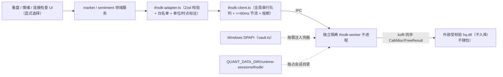

# 增强数据源方案规划：THSDK 调研与观澜自有适配路线

> **状态：仅立项规划（未实施）——待本轮 UI 布局与降噪改造全部完成后，经用户评审确认再启动**

- 规划日期：2026-11-19
- 所属模块：`data-sources`（见 [模块地图](../modules/README.md) 与 [数据源适配](../modules/data-sources.md)）
- 调研基线：`thsdk` PyPI 发行包 `v2.0.2`（上传时间 `2026-09-05`，`thsdk-2.0.2.tar.gz`，22,590,742 字节）及观澜当前数据源实现
- 范围声明：本文件仅做技术调研、架构对比与分阶段规划；未安装任何依赖、未修改业务代码、未触碰生产数据库或打包产物

---

## 1. `thsdk` 深度调研结论（基于 PyPI `v2.0.2` 实证核查）

以下事实均来自对 `https://pypi.org/pypi/thsdk/json` 元数据及 `thsdk-2.0.2.tar.gz` 归档结构的只读核验，非二手转述。

### 1.1 核心能力清单（共 96 个公开函数）

`thsdk` 是面向 Python（`>=3.10`，依赖 `pandas>=1.3.0`）的**纯同步拉取型**证券数据 SDK，底层无客户端实例化概念，采用进程级全局单例。其 96 个公开 API 分为三层：

- **认证、会话与清单（4）**：`auth()`、`auth_qrcode()`、`logout()`、`method_inventory()`。
- **便捷数据 API（12）**：建立在标准 API 之上的薄封装，默认返回 `pandas.DataFrame`，包括 `get_price`、`klines`、`intraday_data`、`tick_level1`、`depth`、`corporate_action`、`search_symbols`、`complete_ths_code`、`wencai_nlp`、`news`、`market_securities`、`block_constituents`。
- **标准 API（80，与底层原生组件方法一一对应）**：

| 能力域 | 数量 | 核心覆盖能力 | 关键约束与实证细节 |
| --- | ---: | --- | --- |
| 行情、交易序列与基本面 | 17 | 多周期 K 线（`1m/5m/15m/30m/60m/120m/day/week/month/quarter/year`）、带前收日线、当日/指定日分时、盘前盘后分时与逐笔、普通逐笔/成交明细、**批量五档盘口**（`list_security_order_books`）、**个股与指数集合竞价**（开盘/收盘/自定义）、**分价表/价量分布档位**、每日资金流、公司行为/除权除息、期权 Greeks、**财务快照** | 复权枚举：`NONE(0)` / `FORWARD(1)` / `BACKWARD(2)`；**不支持推送订阅、不支持 Level-2**（`OrderBookDepth` 仅有 `"5"`）；**`list_security_financial_snapshots` 枚举仅包含 3 个字段**（`total_shares`、`float_shares`、`net_asset_per_share`），**并非完整三张财务报表** |
| 市场目录、证券发现与关系 | 18 | 市场元数据、证券名称、代码/拼音/名称搜索、短代码补全、市场证券分页、板块解析与简介、**板块成分股（支持服务端排序）**、个股所属板块/行业映射/概念标签、行业下级树、A/H 股关系、股票-期货关联 | 证券标识强制为 **4 位字母市场码 + 代码**（如 `USHA600519`、`USZA300033`），跨源必须经显式映射与身份校验，不得硬拼 |
| 资讯、事件与异动 | 14 | **涨停分析**（`analyze_security_limit_up`）、涨跌停事件、短线亮点、集合竞价异动、市场异动/短线事件、热门板块日历事件、7×24 快讯、个股资讯时间线/标记、研报列表、商品-股票联动资讯 | `InfoType` 覆盖 A 股、公告、研报、盘口解读、港美股、期货、外汇等 30+ 分类 |
| 实时统计、排行与排序 | 11 | **按实时信号筛选**（`limit_up` / `limit_down` / `limit_up_break` / `limit_down_break`）、实时涨停统计（首封/末封时间、涨停类型/状态）、**个股热度排名与热度榜**、指数/板块涨跌贡献度排行、自定义股票池/板块服务端排序 | 同步快照查询，不提供交易所级撮合时间戳承诺 |
| 问财 NLP | 7 | 自然语言选股、表达式字段查询、热门概念/行业板块、个股问财实时字段、板块按问财字段排序 | 与观澜已有 `hithink` 问财链路存在业务重叠，但底层走非官方客户端会话而非 `openapi.iwencai.com` API Key |
| 账户权限与自选股 | 13 | 权限查询（1）、自选股与分组读取（2）、**远端自选股写操作（10，含 `clear_account_watchlist` 清空全部自选）** | 含破坏性远端写操作，**严禁在观澜中暴露或调用** |

### 1.2 底层实现机制（最关键的架构发现）

对 `thsdk-2.0.2.tar.gz` 内部文件与 `hq.dll` 二进制指纹的只读核查证实：

1. **核心是闭源 Go `c-shared` 动态库，而非纯 Python 协议实现**：
   - `thsdk-2.0.2.tar.gz` 体积达 **22.59 MB**，内含 5 份预编译共享库：
     - `thsdk/libs/windows/amd64/hq.dll`（11,536,896 字节，约 11.54 MB）
     - `thsdk/libs/linux/amd64/hq.so`（12.51 MB） / `linux/arm64/hq.so`（11.68 MB）
     - `thsdk/libs/darwin/amd64/hq.dylib`（11.27 MB） / `darwin/arm64/hq.dylib`（10.48 MB）
   - Windows 版 `hq.dll` 的二进制指纹明确显示其由 **Go 1.27.0 + MinGW GCC (`x86_64-posix-seh`)** 以 `c-shared` 模式编译，主包路径为 `thshq/cmd/quote_c`。仓库及 PyPI 中均**不提供 Go 源码**。
2. **极简 3 符号 C ABI + 严格 JSON-RPC 协议**：
   - `hq.dll` 仅导出 3 个 C 函数：`Call`、`CallAlloc(const char* request_json) -> void*`、`FreeResult(void* ptr) -> void`。
   - Python 层（`_runtime.py`）通过 `ctypes.CDLL` 加载，使用 `RLock` 串行化跨 FFI 调用；启动时做三重握手校验：
     1. `version` 返回 `abi_version === "2.0.0"`；
     2. 严格解码探针（传入未知字段 `thsdk_protocol_probe: true`，必须返回 `ok: false` 且 `error.code === "invalid_request"`）；
     3. `methods` 返回列表与静态清单 `NATIVE_METHOD_NAMES` 完全一致。
   - 协议硬限制：单请求编码 ≤ 1 MiB、方法名 ≤ 128 字节 ASCII 小写 `snake_case`、JSON 嵌套 ≤ 64 层、禁止 `NaN`/`Infinity`、单次超时上限 600 秒。
   - 支持环境变量 `THSDK_RUNTIME_PATH` 覆盖动态库路径。
3. **内置原生限频与并发模型**：
   - 底层运行组件内置 **50 ms 限频窗口**（见 `thsdk/examples/loop.py`），超频返回 `error.code = "rate_limited"` 与 `retry_after_ms`；上层仅对 `retry_after_ms <= 1000` 自动退避重试 1 次。
   - 单进程全局单例 + 互斥锁，底层非面向高并发连接池设计。
4. **强制认证与内置共享游客账号风险**：
   - 任何业务接口在未认证前均返回 `NotAuthenticatedError`。
   - 三种登录方式：
     - **显式账密 / 环境变量（`THS_USERNAME` / `THS_PASSWORD`）**：由用户名派生确定性本地管理 MAC 地址（`sha256("thsdk-account-mac-v1\0" + username)`）；
     - **扫码登录（`auth_qrcode`）**：轮询 `scan_url` / `image_url` 直至 `authenticated`；
     - **无参 `auth()` 兜底**：先尝试读取当前工作目录 `account.session`，失败后从 `_temporary_accounts.py` 中随机抽取 **52 个硬编码共享游客账号（`thsguest_*` + 明文哈希密码 + 伪造 MAC）** 登录。
   - 会话以明文/不透明文件 `account.session` 保存在 `session_dir`（默认当前工作目录），多进程共享同一目录极易产生文件竞争与会话互踢。
5. **开源许可、供应链与合规风险**：
   - PyPI 元数据与 `LICENSE` 文件标注为 **MIT License (`Copyright (c) 2024 Marjorie Floyd`)**，但**该 MIT 文本与 11.5 MB 闭源二进制 `hq.dll` 之间存在显著的审计与权属断层**：
     - 无法审计 `hq.dll` 内部是否仅连接同花顺服务器、是否上报设备/账号信息或存在隐蔽逻辑；
     - 底层实现的是非官方公开的同花顺私有客户端协议，违反平台 ToS 可能导致账号风控/封禁，且上游协议变更时调用方完全受制于闭源作者更新；
     - `_temporary_accounts.py` 内置的 52 个共享账号属于极高脆弱性资产（全网用户共用、随时批量封禁或限频）；
     - 在 Windows 桌面环境下，非签名第三方 Go C-shared 逆向行情 DLL 存在被 Windows Defender 或安全软件误报隔离的风险。

### 1.3 社区已知坑点与工程限制

- **账号与风控**：高频批量轮询极易触发限流或账号风控；绝不能使用存有资金的实盘主力同花顺账号。
- **会话失效与多进程冲突**：`account.session` 会因服务端过期、异地登录或长期静默失效，且多进程并发写同一 `session_dir` 会破坏会话文件。
- **功能边界误解**：无实时推送、无 Level-2、财务接口仅 3 个股本/净资产快照字段（不能替代财务报表库）。
- **版本演进不稳定**：PyPI 仅发布 `1.7.18`（2026-04）→ `2.0.1` / `2.0.2`（2026-09），大版本直接重构 ABI 与函数命名（README 中甚至仍混写“THSDK 3.x 公开 96 个函数”），上游契约稳定性较弱。

---

## 2. 观澜现有数据源架构盘点与缺口分析

依据 [architecture.md](../architecture.md)、[invariants.md](../invariants.md)、[market-source.ts](../../src/lib/market/market-source.ts)、[tstdx](../../packages/tstdx/src/index.ts) 及 `src/server/data-sources/`、`src/server/market/` 现状盘点如下：

| 现有数据源 | 所在位置与运行形态 | 现有覆盖能力 | 已知限制与缺口 |
| --- | --- | --- | --- |
| **本地通达信 `vipdoc` + `gbbq` + 本地财务** | `packages/tstdx/src/local/` + `BarStore`（`QBARCOL1 v2`） | A 股日线/5m 原始行情、前/后复权因果计算、除权三态、专业财务（GP/BK/SC/FN 全量字段）、本地自选/行业板块 `Blocks`、研究/回测/RPS/台账唯一权威基线 | 仅离线只读，无盘中实时快照/五档/集合竞价/分时/资金流/实时涨停情绪；依赖用户维护本地下载 |
| **`tstdx`（自定义 TDX 7709 TCP）** | `packages/tstdx` + `src/server/data-sources/tstdx/tstdx-adapter.ts` + `tdx-quotes.ts` | 纯 TS 自研协议（零闭源二进制、零登录）；支持 K 线、五档快照（`securityQuotes`）、分时（`minutes`/`historyMinutes`）、逐笔、xdxr、板块 dat、基础财务 | 公共 7709 节点无 SLA 且握手易受服务端调整影响（见 `2026-09-15-tstdx-handshake-fix.md`）；快照时间缺日期字段；量额单位存在未核验项；无涨停分析、异动、资金流、概念标签、热度排行 |
| **东方财富 HTTP** | `src/server/data-sources/eastmoney/`（`eastmoney-adapter.ts`、`em-limit-pool.ts`、`em-datacenter.ts`） | K 线（日/周/月/5~60m，前/后/不复权）、涨停/炸板/跌停/昨涨停四池与情绪统计、部分数据中心查询 | 易受公网反爬/限流影响；`lmt` 不生效需日期截断；四池为单一来源，缺交叉校验、涨停原因、集合竞价异动与五档/分时补充 |
| **腾讯 `westock-data`** | `src/server/data-sources/westock/`（外部 Node CLI 子进程） | A 股/ETF/指数/板块 K 线与搜索 | 依赖外部技能目录 CLI；分钟线限近 28 天不复权、不支持北交所/指数/板块分钟；批量混合查询偶发遗漏 ETF；量额取整、上限 2000 根 |
| **同花顺问财 `hithink`** | `src/server/data-sources/hithink/`（HTTP `openapi.iwencai.com`） | 行业背景、基本面、经营、股东、研报、宏观、选股等结构化表格 | 依赖 `IWENCAI_API_KEY` 商业/开放平台配额，非行情/盘口/分时接口 |
| **其他市场 / 资讯** | `binance`、`crypto-venues`、`sina`/`eastmoney`/`yahoo` 期货、`cls` 本地库、`mx-ds-mcp` | 币种/期货独立行情；CLS 本地新闻库；东财自然语言查询 | 各自独立市场边界，不参与 A 股图表或盘口 |

### 现有体系的真实高价值缺口

1. **看盘盘中增强缺口**：A 股看盘页缺少稳定且字段完整的**实时五档盘口、集合竞价行情、当日分时与分价表**补充源（当前仅 `tstdx` 公共 7709 节点提供基础五档/分时，且无日期确认与 SLA 保障）。
2. **打板情绪与异动缺口**：`/scan?tab=sentiment` 当前单点依赖东方财富 `push2ex` 四池，缺少**涨停原因分析、集合竞价异动、盘中异动事件与热度排名**，且东财接口抖动时无第二验证源。
3. **在线 K 线与动态板块参考缺口**：当本地 `vipdoc` 未更新且 `tstdx` 节点/东财限流时，缺少高可用显式灾备在线源；动态概念标签、行业层级映射与板块成分实时排序在离线 `Blocks` 之外缺少按需参考入口。
4. **明确不缺的部分**：本地日线/5m 历史研究底库、GBBQ 因果复权、本地专业财务三表、RPS 与公式选股底池、纸面账户与回测撮合输入均**已有严谨且经过不变量验证的权威链路**，绝不应引入 `thsdk` 去替代或混拼。

---

## 3. 「观澜自有版本」架构方案对比与推荐

鉴于 `thsdk` 核心是闭源 11.5 MB Go 动态库 `hq.dll`（仅导出 `CallAlloc`/`FreeResult` 三个 JSON-RPC 符号），转为观澜自有集成共有三种工程路线：

| 对比维度 | 方案 A：纯 TS 协议自研（`packages/ts-ths`） | 方案 B：隔离串行子进程 + `koffi` 直连外部 `hq.dll`（借鉴 `czsc-worker`） | 方案 C：隔离常驻 Python 子进程桥接用户本机 `thsdk` |
| --- | --- | --- | --- |
| **核心实现** | 逆向同花顺客户端通信协议、登录加密与 80 个业务报文，纯 TS 编解码 | 在独立 `fork()` Node 子进程内用观澜已有的 `koffi ^3.2.1` 直调 `CallAlloc`/`FreeResult`，全量 TS 契约校验与节流 | 独立常驻 Python 子进程通过 stdin/stdout NDJSON 桥接用户本机 `pip` 安装的 `thsdk` |
| **零闭源二进制分发** | 是（完全开源可控） | **条件满足**：若采用「外置路径配置 + SHA-256 校验，不入库、不打入 `release/win-unpacked`」则仓库零闭源分发；若随包分发则引入 11.5 MB 闭源 DLL | **完全满足**：仓库零闭源二进制，完全由用户本机环境提供 |
| **运行时外部依赖** | 无 | **无 Python / `pandas` 依赖**，复用观澜现有 bundled Node + `koffi` | 强依赖用户本机 Python `>=3.10` + `pandas` + `thsdk` |
| **研发与维护成本** | **极高**（协议加密复杂、80 接口逐一抓包验证、上游改版即全线返工） | **低–中**（ABI 仅 3 函数，TS 封装一次可覆盖所需白名单子集；但受制于上游 `hq.dll` 更新） | **低**（复现最小白名单 bridge 脚本即可；跟随 `pip` 升级） |
| **故障与状态隔离** | 进程内纯 JS，无原生崩溃风险 | **强隔离**：参照 `src/server/strategies/chan/czsc.ts`，单子进程 + 全局 Promise 串行队列；DLL 崩溃仅重启 worker，不拖垮 standalone 服务 | **强隔离**：Python 崩溃或 OOM 仅重启子进程，不拖垮服务 |
| **打包（`release/win-unpacked`）影响** | 极小（纯 JS） | 外置模式：+0 MB（仅增 1 个小型 `thsdk-worker.cjs`）；内置模式：+11.5 MB 且触及闭源再分发与杀软误报 | +0 MB（仅增 1 个桥接脚本），但开箱即用性依赖用户预装 Python 环境 |
| **合规与安全边界** | 需自行承担私有协议逆向法律/ToS 风险，风险不低于调用现成包 | 不再分发闭源 DLL；须明示风险并禁用内置 52 个共享游客账号；仅支持白名单只读方法 | 同左，供应链边界最清晰（用户显式自行安装第三方包） |

### 推荐架构定位：**「观澜自有 TS 契约层 + 可插拔隔离驱动（首选方案 B-外置版，备选方案 C）」**

1. **明确否决方案 A（现阶段不做全协议纯 TS 逆向）**：
   - 与通达信 7709（无登录、无强加密、社区已有多年稳定帧定义）不同，同花顺私有协议含登录态、设备指纹、账号会话与 80+ 业务方法，全自研投入产出比极低且维护脆弱。
2. **明确否决「把闭源 `hq.dll` 提交入仓库或默认打入 `release/win-unpacked`」**：
   - 规避闭源不可审计二进制随正式包分发的供应链风险、许可模糊性、+11.5 MB 体积膨胀及杀软误报。
3. **推荐分层设计（职责解耦，严格符合 `docs/modules/data-sources.md`）**：
   - **纯契约与校验层**（`src/server/data-sources/thsdk/thsdk-contract.ts` 与 `thsdk-mapper.ts`）：
     - 观澜自有 TypeScript Schema（`zod`）、代码映射（`sh600519 <-> USHA600519`）、字段白名单、单位/时点/复权/缺失归一化、`null` vs 有效 `0` 区分、脱敏错误分类；不耦合具体传输介质。
   - **隔离运行驱动层（二选一，由用户评审拍板）**：
     - **主推（方案 B-外置版）**：完全复用观澜成熟的 `czsc.ts` / `czsc-worker.ts` 范式——新增 `runtime/thsdk-worker.cjs` 专用 Node 子进程 + 主进程全局串行队列（禁止 `koffi async` 与并发进入 DLL）；由用户在系统设置中指定外部 `hq.dll` 路径（或自动探测本机受控路径）并校验 **SHA-256 + `version === "2.0.0"` + 严格探针 + 白名单方法集**；进程内集成 **≥60ms 令牌桶节流器**（高于底层 50ms 硬限频）与熔断器（连续 `rate_limited` / 鉴权失败自动冷静期）；**完全免去 Python 与 `pandas` 依赖**，且 `CallAlloc`/`FreeResult` 内存释放严格在 `try/finally` 内完成。
     - **备选（方案 C）**：若用户偏好完全不直接用 `koffi` 加载第三方 DLL，则改为常驻 Python 桥接子进程（类似 `cls-news` 复用已保存的 Python 解释器路径），以 NDJSON 长连接复用单次登录会话，避免每次请求冷启动重复认证触发风控。
   - **会话与凭证边界**：
     - 账号密码/会话秘钥必须走 `src/server/vault.ts`（Windows DPAPI，仓库外 `QUANT_DATA_DIR/credentials/`），绝不落明文配置或日志；
     - `hq.dll` 要求的 `session_dir` 强制隔离到 `QUANT_DATA_DIR/runtime-sessions/thsdk/`（独占目录、不进入仓库 cwd、不纳入 `db/backups.ts` 业务备份轮换）；
     - **默认禁用 `_temporary_accounts.py` 中的 52 个共享游客账号**，避免多用户共用凭据引发的隐性限频与安全隐患（仅在用户明确知情并手动勾选「评估模式」时才考虑，默认关闭）。

---

## 4. 能力映射表：高价值 vs 冗余重叠 vs 明确不做

| 能力类别 | `thsdk` 对应 API | 观澜目标场景 | 纳入结论 | 决策依据与不变量边界 |
| --- | --- | --- | --- | --- |
| **五档盘口与分价表** | `list_security_order_books`、`list_security_price_volume_levels` | `/scan` 看盘侧栏五档/分价参考 | **高价值（纳入）** | 补齐本地离线源空白，较 `tstdx` 公共节点多一层灾备；仅作盘中展示，标明快照获取时间，不入策略/回测 |
| **集合竞价与分时** | `list_security_call_auction_quotes`、`list_index_call_auction_quotes`、`list_security_intraday_bars` | `/scan` 竞价观察与分时图显式切换 | **高价值（纳入）** | 弥补当前集合竞价数据源缺失；分时明确标记 `delayed`/未完成状态，不写入 `BarStore` 原价缓存 |
| **涨停分析与异动补充** | `analyze_security_limit_up`、`list_securities_by_realtime_signal`、`calculate_security_realtime_statistics`、`list_market_call_auction_unusual_events`、`list_market_change_events` | `/scan?tab=sentiment` 情绪交叉校验与涨停归因参考 | **高价值（纳入）** | 消除东财 `push2ex` 单点依赖，补充涨停原因与竞价异动；与东财源严格分列展示来源，不静默合并去重 |
| **板块成分/行业概念参考** | `list_block_constituents`、`list_security_block_memberships`、`get_security_concept_tags`、`list_security_industry_mappings` | 板块成分动态对照、个股概念标签展示 | **中–高价值（按需只读）** | 仅作为「当前时点参考」，**严禁冒充历史行业归属或进入 V4 证券池时点审计/历史研究池** |
| **个股资金流与热度** | `list_security_daily_capital_flows`、`get_security_popularity_rank`、`rank_securities_by_popularity` | 看盘辅助参考卡片 | **中价值（按需只读）** | 显式标注同花顺口径与获取时点，不得冒充全市场成交明细或写入策略因子主口径 |
| **多周期 K 线** | `list_security_k_lines`、`list_security_daily_k_lines_with_previous_close` | `/scan` 在线图表**显式可选灾备源**（`marketSourceSchema` 新增独立选项） | **中价值（仅显式灾备）** | **不进入 `auto` 默认优先链路**（或仅在用户显式开启时作为末位灾备）；严禁替代本地 `vipdoc` + `BarStore`；严禁跨源拼接历史 |
| **公司行为/除权** | `list_security_corporate_actions` | 仅作 GBBQ 核对对照样本 | **低价值（与本地 GBBQ 重叠）** | 观澜已由 `tstdx/local/gbbq` 提供唯一因果复权与除权三态，不引入第二套复权真相源 |
| **财务快照（3 字段）** | `list_security_financial_snapshots` | 无（仅股本/每股净资产 3 字段） | **不纳入主链路（重叠且不完整）** | 观澜本地 TDX 财务库（FN/GP/BK/SC）已完整覆盖三表且有严格公告日可见性约束 |
| **7×24 快讯与研报** | `list_news_flash_items`、`list_security_research_reports` | 与现有 `cls-news` / `intel` 重叠 | **暂不纳入** | 现有 CLS 本地库已具备稳定离线存档与复盘流程，避免重复建设资讯库 |
| **问财 NLP 选股** | `query_wencai`、`query_wencai_securities` 等 7 项 | 与现有 `src/server/data-sources/hithink/` 重叠 | **暂不纳入** | 已有正式 `openapi.iwencai.com` 适配与列校验；非官方会话高频调用问财风控极高 |
| **账号自选股写操作** | `add/remove/replace/clear_account_watchlist*`（10 个写接口） | 无 | **明确禁止** | 破坏性远端写操作，违反观澜“外部源只读、无未经授权外部写动作”纪律 |
| **期权 Greeks / 盘前盘后 / 港美股** | `list_security_option_greeks`、extended hours 等 | 非当前个人沪深工作台授权范围 | **明确不做** | 遵守仓库范围纪律，不顺手扩展未授权市场与衍生品 |
| **实盘交易 / 自动下单 / 策略主输入** | 无（SDK 本身不含交易，但须防误用） | 研究/回测/RPS/台账/纸面账户 | **明确禁止** | 非权威可复现数据源，绝不接入冻结研究快照、回测撮合、RPS 排名、统一提醒 live 入场或纸面记账 |

---

## 5. 严格遵守 `docs/invariants.md` 的核心设计约束

1. **来源、时点、复权与延迟语义全显式化**：
   - 每个 `thsdk` 适配响应必须附带 `version`（如 `thsdk-adapter-1`）、`source: "thsdk-hq"`、`fetchedAt`（本机拉取时刻）、`dataAsOf`（源报文自带交易日/时间，若无则填 `null`，绝不用 `fetchedAt` 冒充行情时点）、`adjustment`（`none | qfq | hfq | not-applicable`）、`delayed`（未证实实时前默认标注 `true` 或 `unverified`）、`volumeUnit`（逐品种独立核验前标注「源单位未独立核验」）与 `warnings[]`。
2. **原始值 / 未知（`null`）/ 有效零（`0`）严格三分**：
   - 任何字段缺失、非有限数（`NaN`/`Infinity`）、类型不符或解析异常，一律保留 `null` + 固定原因码，或令整条 item 返回 `status: "invalid"`；严禁以 `0`、`""` 或上一笔值静默填补。
   - 合法的 `0`（如停牌日零成交量、涨停无卖盘档位量 `0`）必须与「字段未返回（`null`）」严格区分。
3. **禁止静默回退与跨源拼接**：
   - 当用户显式选择 `thsdk`（含 `connection-check.ts` 连接检查与图表切源）失败时，必须直接返回结构化脱敏错误（区分 `rate_limited` / `auth_required` / `session_expired` / `timeout` / `invalid` / `empty` / `unavailable`），**绝不静默切回东财/本地源冒充成功**。
   - 严禁把 `thsdk` 尾部 K 线拼接到本地 `BarStore` 或 `tstdx`/东财历史序列上；盘中当日叠加若未来启用，必须复用现有重叠价量核对机制，并明确标记为未完成临时覆盖、不写回原价列缓存。
4. **本地通达信只读与研究冻结口径隔离**：
   - 本地 `vipdoc`、`gbbq` 与 `Blocks` 目录继续保持严格只读；`thsdk` 永不写入本地通达信目录，也不得改变既有 RPS、公式选股、双突破、缠论、研究快照、回测引擎（`quant-backtest`）、信号台账和纸面账户（`src/server/paper/`）的任何输入口径。
5. **最小代表样本核验先行（强制前置门禁）**：
   - 在编写任何业务页面接入之前，必须先选取 **3 只代表标的 + 1 类异常边界样本**，在同一交易日收盘后与本地 `vipdoc` + `gbbq`、`tstdx` 7709、东方财富 HTTP 逐项对拍：
     - `sh600519`（贵州茅台：沪市主板、高价、高频分红，核对价格精度与前/后复权口径差异）；
     - `sz000001`（平安银行）或 `sz300033`（同花顺：深市/创业板，核对 10%/20% 涨跌幅、除权送转与成交量股/手单位）；
     - `sh510300`（沪深 300 ETF：3 位小数精度基金，核对是否发生 2 位截断及成交量单位倍率）；
     - 边界样本：当日涨停/跌停股（核对卖一/买一空档是否为 `null` 或 `0`）及停牌股（核对零成交与日期连续性）。
   - 只有当价格精度、量额单位、时区/时间戳、复权算法差异与缺失语义全部形成书面实证表后，才允许进入正式适配阶段。
6. **白名单最小权限与脱敏**：
   - `thsdk-worker` 内硬编码允许调用的**只读方法白名单**，任何不在白名单内的 method（尤其是 10 个自选股写接口）在进入 FFI 前直接拒绝；
   - 错误消息与日志严禁输出用户名、密码、MAC、`account.session` 内容或内部路径。

---

## 6. 分阶段实施路径（Wave 0 – Wave 4）

> 以下阶段均在**本轮 UI 重设计全部收口并获用户明确立项授权**后依次执行；每阶段独立可验收，遇停止条件立即止损汇报。

### Wave 0：决策拍板与最小代表样本对拍（不改业务代码）

- **目标**：敲定架构与合规决策，并在独立隔离脚本中完成最小样本实测取证。
- **交付物**：
  - 用户签字确认的架构决议（写入 `docs/decisions.md`，确定方案 B-外置版或方案 C、认证方式、打包边界）；
  - 代表样本对拍记录（存入 `docs/data-sources/YYYY-MM-DD-thsdk-sample-verification.md`）：覆盖 `sh600519`、`sz300033`/`sz000001`、`sh510300` 及涨停/停牌样本在 K 线、五档、分时、集合竞价、涨停分析上的逐字段差异、量额单位与延迟观测。
- **受影响模块**：无生产代码改动（仅独立临时验证脚本，验收后清理）。
- **验证方案**：人工 + 脚本对照本地 `vipdoc`/`gbbq`、`tstdx`、东财 HTTP 输出逐项偏差表，记录不可核验字段。
- **风险与停止条件**：
  - 若实测发现临时账号/个人普通账号在正常看盘频次（如每 5–10 秒 1 次五档）下即频繁封禁或返回空数据，或价格/复权存在不可解释跳变，则**立即终止项目**，不进入 Wave 1。

### Wave 1：隔离运行底座、白名单网关与契约单测

- **目标**：构建与 `czsc-worker` 同级别的故障隔离底座、凭据/会话安全边界和脱敏连接检查能力。
- **交付物**：
  - `src/server/data-sources/thsdk/`：
    - `thsdk-contract.ts`（Zod 输入/输出 schema、代码双向映射、只读方法白名单、脱敏错误分类）；
    - `thsdk-worker.ts`（独立子进程入口：加载外部受控 `hq.dll` 或桥接 Python，校验 SHA-256 + `version` + 严格探针 + 方法清单；`try/finally` 释放 `CallAlloc` 内存）；
    - `thsdk-client.ts`（主进程单例串行队列、≥60ms 节流、熔断器、超时期限、进程崩溃自动回收）；
    - `thsdk-auth.ts`（对接 `src/server/vault.ts` DPAPI 凭据读写 + 扫码登录状态机 + 隔离 `QUANT_DATA_DIR/runtime-sessions/thsdk/`）。
  - `scripts/build-runtime.mjs` 增量注册 `runtime/thsdk-worker.cjs`（仅在选定方案 B 时，复用已有 `runtime/node_modules/koffi`）。
  - 固定成功与非法输入 fixture（位于 `tests/fixtures/thsdk/`）及单测 `tests/data-sources/thsdk-adapter.test.ts`。
- **受影响模块**：`src/server/data-sources/thsdk/`、`scripts/build-runtime.mjs`、`tests/data-sources/`。
- **独立验证方案**：
  - Mock/Fake worker 固定 fixture 测试：验证握手版本不符拒绝、严格探针失败拒绝、非法方法（如 `clear_account_watchlist`）硬拒绝、非法 JSON/`NaN`/超长响应拒绝、`rate_limited` 退避与熔断、worker 异常退出后队列恢复不泄露挂起 Promise、错误日志零凭据泄露；
  - 隔离 `QUANT_DATA_DIR` 下验证 DPAPI 凭据存取与 `account.session` 目录隔离（绝不在仓库根创建文件）。
- **风险与停止条件**：
  - 若 `koffi` 在 Windows x64 下调用 Go `c-shared` DLL 出现 TLS/信号冲突、无法优雅卸载或内存泄露，则停止方案 B，切换至方案 C（常驻 Python 桥接）重新评审。

### Wave 2：显式连接检查、看盘五档/集合竞价与 K 线灾备接入

- **目标**：把经过核验的行情能力以**显式可选**方式接入看盘与系统设置，不改变现有默认行为。
- **交付物**：
  - `src/lib/market/market-source.ts` 与 `src/server/market/connection-check.ts`：新增显式来源标识（如 `"thsdk"`，不默认启用、不改 `"auto"` 默认主序），复用 10 秒超时、取消信号、`localCalendarReference` 新鲜度检查与禁止自动切源不变量；
  - `src/server/data-sources/thsdk/thsdk-adapter.ts`：实现 `thsdkKlines`、`thsdkOrderBooks`、`thsdkIntraday`、`thsdkCallAuction`，遵循与 `tstdx-adapter.ts` / `eastmoney-adapter.ts` 一致的逐项状态结构（`ok | unsupported | unavailable | invalid` + `reason?: "empty"`）；
  - 系统设置页（`/system`）增加 THSDK 外部路径/登录状态（扫码或 DPAPI 账密）/显式开关配置与手动连接自检入口；
  - `/scan` 看盘页按需展示五档盘口/集合竞价参考（隐藏标签时遵守 `PanelVisibility` 停止一切轮询）。
- **受影响模块**：`src/lib/market/market-source.ts`、`src/server/market/connection-check.ts`、`src/server/market/free-chart-sources.ts`、对应 tRPC router 与 `/system`、`/scan` 局部展示组件。
- **独立验证方案**：
  - `tests/data-sources/connection-check.test.ts` 扩展：覆盖未配置/未登录/会话过期/限流/空响应/坏包/超时取消；
  - 断线与降级测试：模拟请求中 worker 崩溃、会话失效、连续 429/rate_limited，验证 UI 呈现明确降级提示且不阻塞主图表、不误写本地缓存；
  - 确认现有 `market-source-selection.test.ts`、研究/回测/RPS/台账回归测试全绿，零隐式切源。
- **风险与停止条件**：
  - 若接入后引入任何未授权的后台自动请求（例如启动应用或切换无关页面即自动登录/拉取），视为违反边界，立即拦截修复。

### Wave 3：情绪/涨停归因、板块成分与资金流只读参考增强

- **目标**：释放 `thsdk` 相比 `tstdx` / 东财最独特的高价值能力——涨停分析、异动事件、动态概念与资金流参考。
- **交付物**：
  - `src/server/data-sources/thsdk/thsdk-sentiment.ts` 与 `thsdk-blocks.ts`：封装涨停分析、实时涨跌停信号统计、集合竞价异动、板块成分与概念标签、每日资金流只读适配；
  - `/scan?tab=sentiment` 增加可选的「同花顺涨停归因/交叉校验」辅助视图（与东财四池分源标注，标注拉取时点，不篡改东财历史定稿缓存）；
  - 个股/板块侧栏按需展示当前概念标签与资金流参考，显式注明「当前截面参考，不代表历史归属」。
- **受影响模块**：`src/server/data-sources/thsdk/`、`src/server/market/limit-sentiment.ts`（只读扩展，不改核心定稿结构）、`/scan?tab=sentiment` 与看盘侧栏。
- **独立验证方案**：
  - 固定 fixture 验证缺失/非交易日返回 `available: false` 或 `null`，不补造零值；
  - 验证 V4 证券池时点审计（`tests/screening-rps/universe-audit.test.ts`）仍保持零外呼、不受新源污染。
- **风险与停止条件**：
  - 若上游涨停/板块接口字段漂移频繁或需要高权限付费账号才能返回完整数据，则收敛仅保留实测稳定的子集（如五档 + K 线灾备），其余标记不可用并移除入口。

### Wave 4：隔离全链路验收、性能观测与桌面打包收口

- **目标**：在隔离 `QUANT_DATA_DIR` 下完成集成验证、性能压测（节流与切页暂停）及 Electron 打包边界确认。
- **交付物**：
  - 隔离 `QUANT_DATA_DIR` 下的端到端验收记录（含关闭状态零网络请求、开启后手动登录→看盘五档→断网降级→登出清理 `account.session`）；
  - 确认若新增 SQLite 持久化字段是否触发新迁移（**优先复用现有 settings/vault，尽量做到零 schema 迁移**，避免使现有正式 exe 过期）；
  - Electron 打包验证（若用户最终批准仅外置驱动，确认 `release/win-unpacked` 体积无异常膨胀且未包含任何闭源 DLL 或测试会话文件）。
- **受影响模块**：`tests/data-sources/`、`docs/modules/data-sources.md`、`docs/decisions.md`（交付时同步更新）。
- **验证方案**：集中执行受影响单测、类型检查、`pnpm check:dependencies`（确认数据源层未反向依赖策略/回测/研究）及隔离桌面烟雾验证。

---

## 7. 待用户提前拍板的关键决策项

在启动 Wave 0/Wave 1 之前，以下 **3 个架构与合规决策** 必须由用户明确拍板：

1. **决策 1（驱动形态与闭源二进制边界）**：
   - **选项 1A（推荐）**：采用 **方案 B-外置版**——观澜自研 `runtime/thsdk-worker.cjs` 串行子进程 + `koffi` 直连用户本机外部 `hq.dll`（设置页配置路径 + 校验 SHA-256），**零 Python 依赖，且仓库与 `release/win-unpacked` 均不分发闭源 DLL**；
   - **选项 1B**：采用 **方案 C**——常驻 Python 子进程桥接用户自行 `pip install thsdk` 的环境（完全不触碰 `koffi` 加载第三方 DLL，但强依赖本机 Python ≥3.10 + `pandas`）；
   - **选项 1C**：因 `hq.dll` 闭源与非官方协议合规风险，**放弃接入 `thsdk`**，转而仅在现有 `tstdx` + 东财 HTTP + 官方 `hithink` 开放平台框架内补齐五档/集合竞价/板块缺口。
2. **决策 2（认证方式与账号风控策略）**：
   - 是否明确**硬禁止使用 `thsdk` 内置的 52 个共享 `thsguest_*` 游客账号**，仅允许用户通过**独立次要同花顺账号**（扫码登录或 DPAPI 加密账密）显式启用，且应用启动默认关闭、绝不静默登录？
3. **决策 3（数据源定位与能力边界）**：
   - 是否确认 `thsdk` 严格限定为**显式可选的盘中看盘/情绪参考/在线 K 线灾备源**，永久隔离于冻结研究快照、回测引擎、RPS、信号台账与纸面账户主链路之外，且永久禁用全部 10 个远端自选股写接口？
