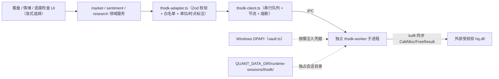

# THS（thsdk-hq）全量数据源打通实施规格

> **状态：方案未实施。** 本文是可执行的实施规格，按依赖推进，不再设置逐阶段审批。

- 规划日期：2026-11-19
- 所属模块：`data-sources`（见 [模块地图](../modules/README.md) 与 [数据源适配](../modules/data-sources.md)）
- 调研基线：`thsdk` PyPI 发行包 `v2.0.2`（上传 `2026-09-05`，`thsdk-2.0.2.tar.gz`，22,590,742 字节）及观澜现有数据源实现
- 定位：同花顺 `hq.dll` 作为观澜的**全量可选数据源**，覆盖全局行情、看盘增强、情绪/板块、问财、资讯与研究可选输入；按数据和用途准入，不替代已冻结的本地研究基线。

---

## 1. 定位与准入原则

`thsdk-hq` 是观澜继本地通达信、tstdx、东方财富、westock-data 之后的又一路径。它补齐盘中五档、分价、集合竞价、分时、涨停归因、异动、板块概念与资讯等能力，并为研究/选股/回测提供**显式可选**输入。

准入按数据和用途判定，不按来源一刀切：

- **展示**：可接带 `fetchedAt`、`dataAsOf`、延迟与来源标签的数据；缺字段保留 `null` 并注明原因。
- **历史计算与研究**：需证明当时可见、来源可追溯、证券身份与量价单位正确、复权和公司行动可解释，并能重放冻结输入。新源生成新版本快照；已有研究、账本和成交事实按原身份读取。
- **远端写操作**：自选股增删、替换、清空属于独立写操作，行情连接检查和其他读取路径不得触发。
- **交易能力**：SDK 不含交易接口；任何"绕过 SDK 下单"的扩展都不在本方案内。

## 2. 上游事实与工程限制（基于 v2.0.2 只读核查）

### 2.1 能力面

`thsdk` 是面向 Python（`>=3.10`，依赖 `pandas`）的同步拉取型 SDK，共 96 个公开函数：认证/会话/清单 4 个、便捷 API 12 个、与底层原生组件一一对应的标准 API 80 个。证券标识为 4 位字母市场码 + 代码（如 `USHA600519`），跨源必须显式映射与身份校验。

### 2.2 驱动实现

- `thsdk-2.0.2.tar.gz` 内含 5 份预编译共享库，Windows 版为 `thsdk/libs/windows/amd64/hq.dll`（11,536,896 字节）。
- `hq.dll` 由 Go 1.27.0 + MinGW GCC 以 `c-shared` 编译，主包路径 `thshq/cmd/quote_c`；上游不提供 Go 源码。
- 仅导出 3 个 C 符号：`Call`、`CallAlloc(const char*) -> void*`、`FreeResult(void*) -> void`。
- Python 层通过 `ctypes.CDLL` 加载并用 `RLock` 串行化；启动做三重握手：`abi_version === "2.0.0"`、严格未知字段探针返回 `invalid_request`、`methods` 与静态清单一致。
- 协议硬限制：单请求 ≤ 1 MiB、方法名 ≤ 128 字节 ASCII `snake_case`、JSON 嵌套 ≤ 64 层、禁止 `NaN`/`Infinity`、单次超时上限 600 秒。
- 底层内置约 50 ms 限频窗口；超频返回 `error.code = "rate_limited"` 与 `retry_after_ms`。单进程全局单例，非高并发连接池设计。
- 会话以 `account.session` 保存在 `session_dir`（默认当前工作目录），多进程共享同一目录会竞争或互踢。

### 2.3 认证与账号

三种登录方式：

1. 显式账密或 `THS_USERNAME` / `THS_PASSWORD`；
2. 扫码登录（`auth_qrcode` 轮询 `scan_url` / `image_url`）；
3. 无参 `auth()` 兜底：先读当前目录 `account.session`，失败后从 `_temporary_accounts.py` 随机抽取 52 个硬编码共享游客账号。

**采用策略**：默认使用用户自己的同花顺账号（扫码或 DPAPI 账密）；用户显式开启"游客快速体验"时，才允许使用供应商随包提供的游客能力。登录失败返回真实状态，不静默切换账号、不自动轮换共享凭据、不在用户不知情时联网登录。

### 2.4 供应链与合规

MIT 文本覆盖 11.5 MB 闭源二进制；无法审计 DLL 内部网络与设备上报行为，底层为非官方私有协议，上游协议变更受制于闭源作者。Windows 下可能被杀软误报。方案据此限制分发方式与调用面，详见 §5。

Windows x64 上的 ABI、内存释放、证券代码映射与全能力字段实证见[真实 ABI 与全能力样本实证记录](2026-11-19-thsdk-sample-verification.md)。

## 3. 观澜现有数据源与缺口

| 现有数据源                              | 覆盖                                              | 主要缺口                                                               |
| --------------------------------------- | ------------------------------------------------- | ---------------------------------------------------------------------- |
| 本地通达信 `vipdoc` + `gbbq` + 本地财务 | A 股日线/5m、因果复权、除权三态、专业财务、Blocks | 无盘中实时快照/五档/竞价/分时/资金流/涨停情绪                          |
| `tstdx` 7709                            | K 线、五档、分时、逐笔、xdxr、板块 dat            | 公共节点无 SLA；快照缺日期；量额单位未全核验；无涨停分析/异动/概念标签 |
| 东方财富 HTTP                           | K 线、涨停/炸板/跌停/昨涨停四池                   | 反爬与限流；单源；缺涨停原因、竞价异动、五档/分时补充                  |
| 腾讯 `westock-data`                     | A 股/ETF/指数/板块 K 线与搜索                     | 分钟线限近 28 天；批量偶发遗漏 ETF；量额取整                           |
| 同花顺问财 `hithink`                    | 行业、基本面、经营、股东、研报、宏观、选股        | 依赖 `IWENCAI_API_KEY`；非行情/盘口接口                                |
| 币安 / 加密场所 / 期货 / CLS / mx-ds    | 各自市场与资讯                                    | 独立边界，不参与 A 股图表                                              |

`thsdk-hq` 的目标是补齐上述缺口，并为研究与选股提供第二参考源；不改变本地 `vipdoc` + `BarStore` + GBBQ 的现行研究基线身份。

## 4. 架构：方案 B（独立 Node 子进程 + koffi 直连）

复用观澜已有的 `czsc.ts` / `czsc-worker.ts` 范式，不引入 Python 运行时。

分层职责：

- **纯契约层** `src/server/data-sources/thsdk/thsdk-contract.ts`：Zod schema、代码映射、只读方法白名单、单位/时点/复权归一、`null` 与有效 `0` 区分、脱敏错误分类。
- **适配层** `thsdk-adapter.ts`：K 线、五档、分价、竞价、分时、涨停/情绪、板块、问财、资讯等具名只读接口，逐项返回 `ok | unsupported | unavailable | invalid`。
- **驱动层** `thsdk-worker.ts` + `thsdk-client.ts`：独立子进程加载校验过的 `hq.dll`；主进程单例串行队列、≥60 ms 节流、熔断、超时与崩溃回收。
- **认证层** `thsdk-auth.ts`：DPAPI 凭据、扫码状态机、游客快速体验开关、独占会话目录。

### 4.1 二进制来源与校验

- 默认由用户在系统设置指定外部 `hq.dll` 路径；仓库与 `release/win-unpacked` 不默认分发闭源 DLL。
- 加载前校验：文件存在、SHA-256 与设置记录一致、`abi_version === "2.0.0"`、严格探针通过、`methods` 与预期清单匹配。
- 若用户明确选择随包分发，则在打包清单中单独登记并提示体积、许可与杀软风险；否则保持外置。

### 4.2 原生调用安全底线

- **禁止 unload Go 运行时 DLL**：进程退出前不调用 `FreeLibrary` 卸载 `hq.dll`；驱动退役时终止整个子进程。
- **有界解码**：响应大小、JSON 深度、数组长度、字符串长度均设上限；超限拒绝并记录固定错误码。
- **释放**：每次 `CallAlloc` 的结果在 `try/finally` 中调用 `FreeResult`，异常路径同样释放。
- **超时强杀**：单次调用超时即终止子进程并重建；不把挂起 Promise 留在队列。
- **最小环境**：子进程使用最小 `env` 与固定 `cwd`（`QUANT_DATA_DIR/runtime-sessions/thsdk/`），不继承无关变量，不在仓库根创建文件。
- **串行**：禁止并发进入 DLL；不使用 `koffi async`。
- **脱敏**：错误消息与日志不输出用户名、密码、MAC、会话内容或内部路径。

## 5. 能力清单与准入

| 能力                            | 上游方法（示例）                                                                                                                         | 观澜用途                      | 准入与边界                                                                          |
| ------------------------------- | ---------------------------------------------------------------------------------------------------------------------------------------- | ----------------------------- | ----------------------------------------------------------------------------------- |
| 多周期 K 线                     | `list_security_k_lines`、`list_security_daily_k_lines_with_previous_close`                                                               | 全局/图表在线源；研究可选输入 | 显式来源；不静默进入 `auto`；不跨源拼接历史；用于研究时生成新版本快照并重放冻结输入 |
| 五档盘口                        | `list_security_order_books`                                                                                                              | `/scan` 看盘                  | 标注快照时间；单有盘口不能认证可成交量                                              |
| 分价表                          | `list_security_price_volume_levels`                                                                                                      | 看盘辅助                      | 标注单位与时点                                                                      |
| 集合竞价                        | `list_security_call_auction_quotes`、`list_index_call_auction_quotes`                                                                    | `/scan` 竞价观察              | 标注延迟与未完成状态                                                                |
| 分时/逐笔                       | `list_security_intraday_bars`、逐笔方法                                                                                                  | 分时图显式切换                | 不写回 `BarStore` 原价缓存                                                          |
| 涨停与异动                      | `analyze_security_limit_up`、`list_securities_by_realtime_signal`、`calculate_security_realtime_statistics`、`list_market_change_events` | `/scan?tab=sentiment`         | 与东财分源标注，不静默合并去重；不冒充全市场成交明细                                |
| 板块/概念/行业                  | `list_block_constituents`、`list_security_block_memberships`、`get_security_concept_tags`、`list_security_industry_mappings`             | 板块参照、个股概念标签        | 当前截面不能倒填历史；进入历史研究需单独证明时点                                    |
| 资金流与热度                    | `list_security_daily_capital_flows`、`get_security_popularity_rank`                                                                      | 看盘辅助卡片                  | 标注同花顺口径与获取时点；不写入因子主口径                                          |
| 问财                            | `query_wencai*` 等                                                                                                                       | 选股参考                      | 与 `hithink` 分源标注；高频调用受风控，按返回期限退避                               |
| 资讯/研报                       | `list_news_flash_items`、`list_security_research_reports`                                                                                | 资讯可选来源                  | 与 CLS 本地库分源；模型只解读带证据内容                                             |
| 公司行为                        | `list_security_corporate_actions`                                                                                                        | GBBQ 核对对照                 | 本地 GBBQ 仍是现行复权基线；对照结果不自动改写                                      |
| 财务快照                        | `list_security_financial_snapshots`                                                                                                      | 辅助参考                      | 仅股本/每股净资产 3 字段，不替代本地三表；缺字段如实标注                            |
| 期权 Greeks / 港美股 / 盘前盘后 | 对应扩展方法                                                                                                                             | 需求驱动                      | 未建立对应市场与消费者前不接入页面；接入时按该市场数据规则单独验收                  |
| 自选股写操作                    | `add/remove/replace/clear_account_watchlist*`（10 个）                                                                                   | 无                            | **禁止**：白名单外的方法在进入 FFI 前直接拒绝                                       |

## 6. 数据语义

每个适配响应至少包含：

- `version`（如 `thsdk-adapter-1`）、`source: "thsdk-hq"`；
- `fetchedAt`（本机拉取时刻）、`dataAsOf`（源报文自带交易日/时间，无则 `null`，不用 `fetchedAt` 冒充行情时点）；
- `adjustment`（`none | qfq | hfq | not-applicable`）、`delayed`（未证实实时前标 `true` 或 `unverified`）；
- `volumeUnit`（逐品种核验前标注未独立核验）与 `warnings[]`。

缺失语义：字段缺失、非有限数、类型不符或解析异常保留 `null` + 固定原因码，或整条 `invalid`；合法 `0`（停牌零量、涨停无卖盘档位）与未返回严格区分。

**防静默串源与重复复权**：

- 用户显式选择 `thsdk` 时，失败返回结构化脱敏错误（`rate_limited` / `auth_required` / `session_expired` / `timeout` / `invalid` / `empty` / `unavailable`），不静默切回东财或本地源。
- 不把 `thsdk` 尾部 K 线拼接到本地 `BarStore`、`tstdx` 或东财历史序列；需要叠加时复用现有重叠价量核对，只标记未完成临时覆盖。
- `thsdk` 返回的复权数据不与本地 GBBQ 叠加二次复权；研究输入只能选择一种复权来源并冻结。

## 7. 故障与局部降级

每种失败都能指出被阻断的能力，其他已验证路径继续工作：

- 限流：按 `retry_after_ms` 退避；连续限流进入冷静期。
- 登录失败/会话过期：停止该会话并提示重新登录；不静默换账号。
- 复权跳变或单位异常：隔离相应序列，保留原值和原因。
- 付费字段不可用：标注 `unavailable`。
- 驱动崩溃或内存泄漏：停止该驱动并回收子进程；其他来源不受影响。
- 空响应：区分"源确实为空"与"请求失败"，不把空数据当成功。

## 8. 实施顺序

按依赖推进，每项可独立验收：

1. **契约与驱动底座**：`thsdk-contract.ts`、`thsdk-worker.ts`、`thsdk-client.ts`、`thsdk-auth.ts`；白名单、节流、熔断、超时、释放、进程回收；离线 fixture 与非法输入测试。
2. **显式连接检查与 K 线**：来源枚举、持久化、连接检查、错误分类；每个在线源用带独立标记的 fake adapter 验证选择与失败不串源。
3. **看盘能力**：五档、分价、竞价、分时；时间标签、隐藏页停轮询。
4. **情绪与板块**：涨停归因、异动、板块成分与概念标签；与东财分源展示。
5. **问财与资讯**：按需只读入口，与现有 hithink/CLS 分源。
6. **研究/选股/回测可选输入**：新版本快照、冻结与重放；按数据/用途准入，不改变已有研究身份。
7. **打包与分发核对**：外置模式下确认 `release/win-unpacked` 不含闭源 DLL 或会话文件；随包分发仅在明确选择后执行。

## 9. 验证

每个能力用能识别其错误的样本核验，例如：

- ETF 三位小数精度、股/手倍率、停牌零量、盘口缺档、涨跌停无挂单；
- 同一交易日的价格、单位、时间戳与本地 `vipdoc`、`tstdx`、东财逐项对照；
- 登录失败、会话过期、限流、空响应、坏包、超时取消与驱动崩溃；
- 显式选源只调用被选中的适配器；失败时其他来源调用次数为零；`local` 独测网络零调用；
- 研究快照能重放冻结输入；未证明可见性的数据不进入历史计算；
- 自选股写方法在白名单外被硬拒绝；
- 日志与错误不含凭据、MAC、会话内容或内部路径。

## 10. 待确认事项

- 用户是否随包分发 `hq.dll`（默认外置）；随包时需确认许可与杀软误报处理。
- 游客快速体验是否默认关闭、在设置页如何标注来源与限制。
- 研究/回测首批可选能力范围（建议从 K 线与板块截面开始，逐项证明时点）。
